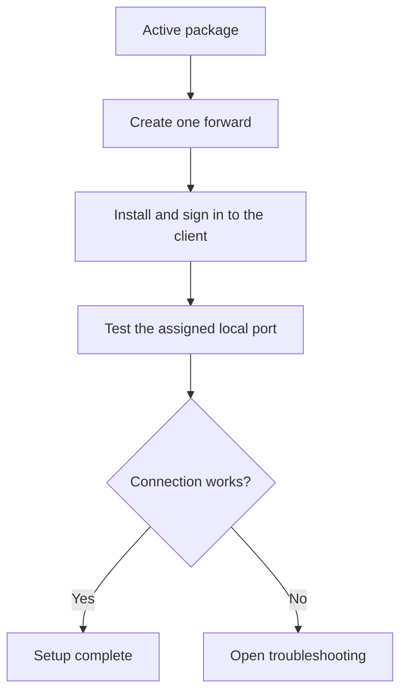
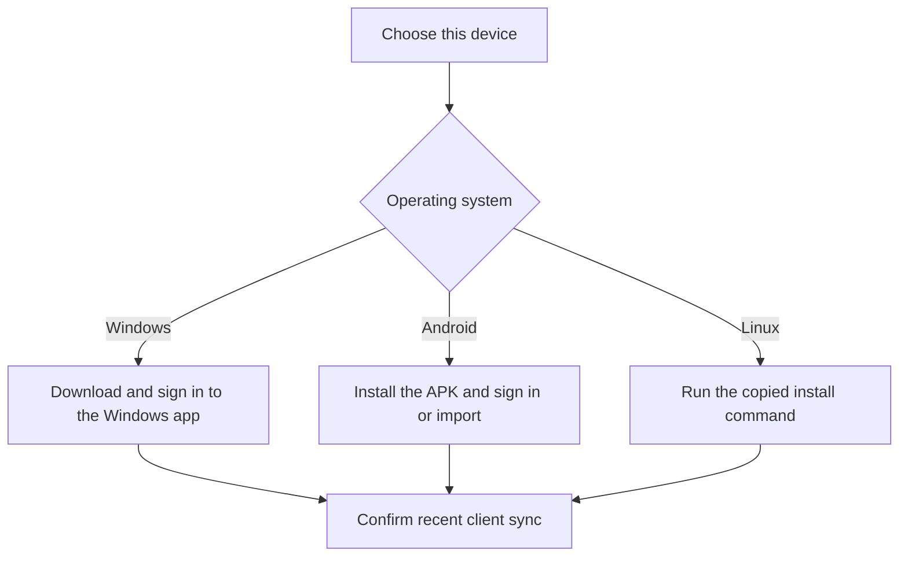
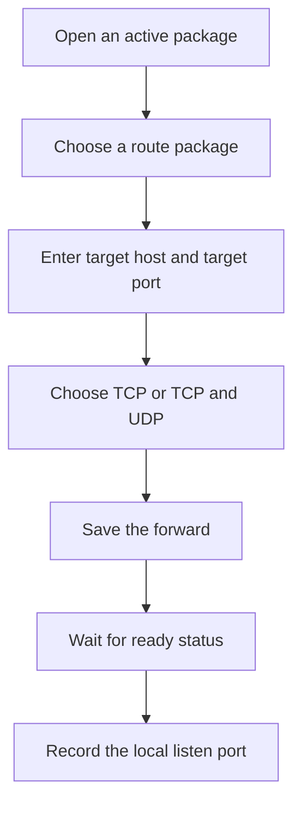
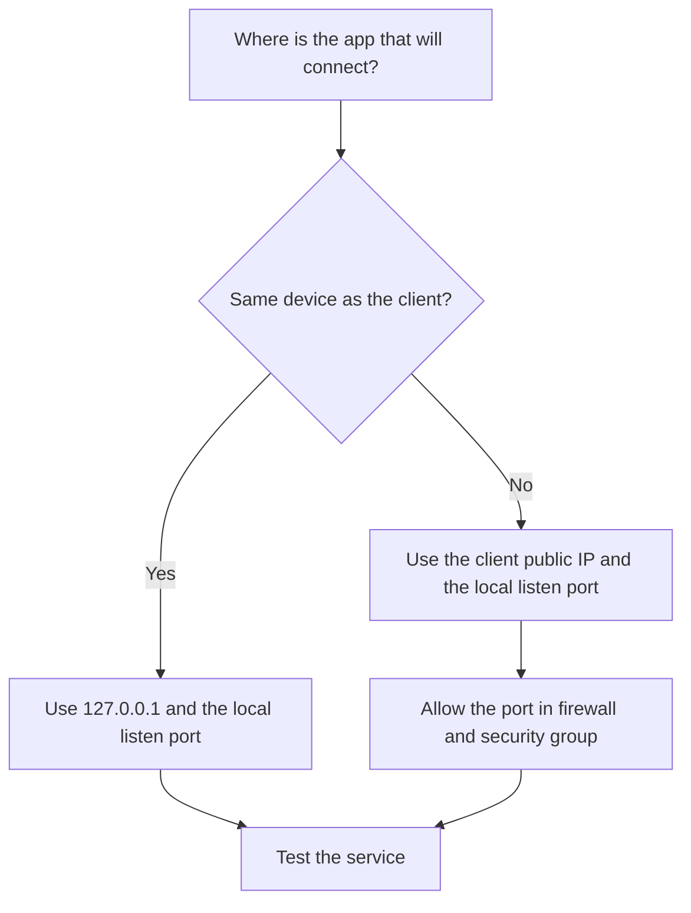
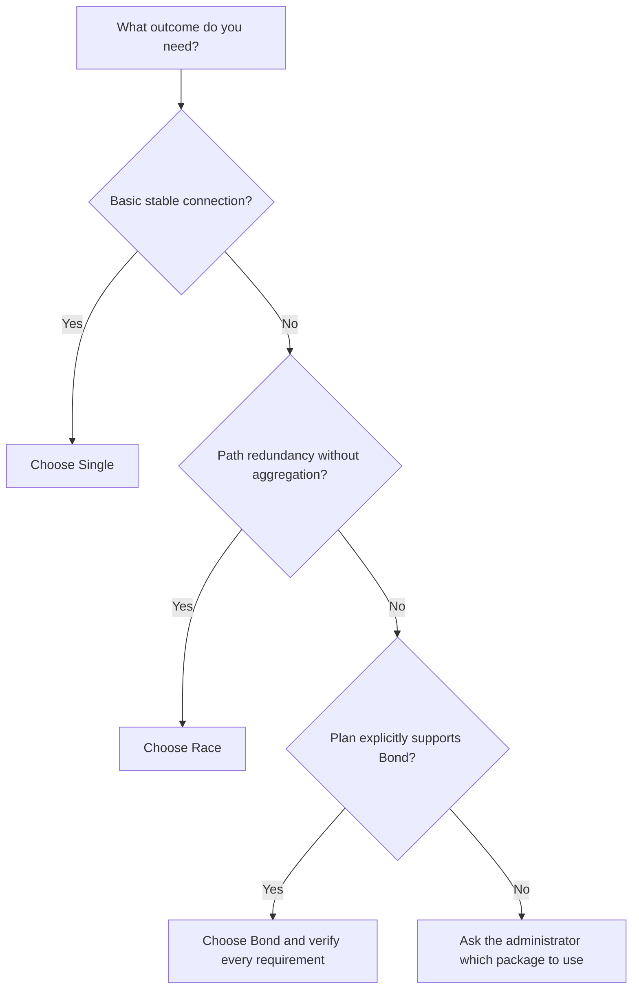
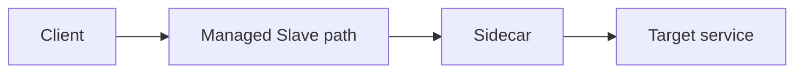
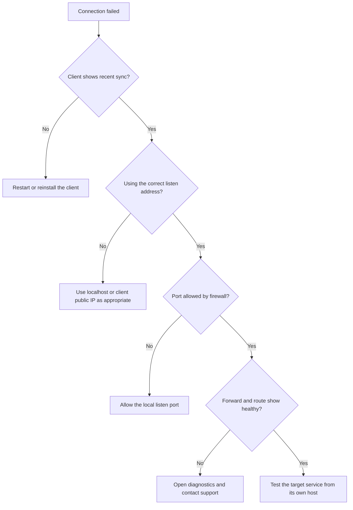

# Multilingual User Guide Redesign Implementation Plan

> **For agentic workers:** REQUIRED SUB-SKILL: Use superpowers:subagent-driven-development (recommended) or superpowers:executing-plans to implement this plan task-by-task. Steps use checkbox (`- [ ]`) syntax for tracking.

**Goal:** Replace the mixed-language knowledgebase with eight beginner-oriented topics, each independently authored in English, Simplified Chinese, and Traditional Chinese, with locale-aware reading, safe Mermaid diagrams, and a language-aware admin editor.

**Architecture:** Add topic and localized-article tables while retaining the legacy table for rollback. Resolve locale on the server from `?lang=` or a same-origin cookie, read the requested article with explicit English fallback, sanitize all rendered article HTML, and render audited local Mermaid assets only when needed. Keep long-form content in versioned resource files and generate the one-time SQL seed migration from those sources.

**Tech Stack:** PHP 8.x, MySQL migrations with SQLite service tests, vanilla JavaScript, existing client-side JSON i18n, vendored Mermaid 11.12.0, HTML/CSS.

---

## File map

### New focused files

- `master/src/Support/LocaleResolver.php` — validates `en`, `zh-Hans`, and `zh-TW`; resolves query-string and cookie precedence.
- `master/src/Support/KnowledgebaseHtmlSanitizer.php` — allowlist sanitizer applied on save and again before render for legacy rows.
- `master/src/Support/MermaidSourcePolicy.php` — extracts Mermaid blocks, enforces the safe flowchart subset, and verifies the browser validation digest before publishing.
- `master/public/assets/knowledgebase-mermaid.js` — renders reader diagrams one by one and leaves source text visible on failure.
- `master/public/assets/knowledgebase-admin.js` — validates Mermaid with the local parser before publishing and routes unsaved editor content to the safe preview action.
- `master/public/assets/vendor/mermaid/mermaid.min.js` — pinned local Mermaid browser bundle.
- `master/public/assets/vendor/mermaid/LICENSE` — upstream license for the vendored bundle.
- `master/public/assets/vendor/mermaid/package.json` — upstream package metadata that locks the vendored asset version to 11.12.0.
- `master/migrations/20260729_add_multilingual_knowledgebase.sql` — creates topic and localized-article tables.
- `master/migrations/20260729_seed_multilingual_knowledgebase.sql` — generated one-time content migration.
- `master/resources/knowledgebase/topics.php` — topic ordering, keys, titles, summaries, and body-file map for all locales.
- `master/resources/knowledgebase/{en,zh-Hans,zh-TW}/*.html` — 24 independently authored article bodies.
- `master/scripts/build_knowledgebase_seed.php` — deterministically generates the seed migration from the resource manifest.
- `master/tests/knowledgebase_locale_resolver_test.php` — locale precedence and normalization.
- `master/tests/knowledgebase_multilingual_schema_test.php` — schema mirror and migration contract.
- `master/tests/knowledgebase_html_sanitizer_test.php` — allowed markup and dangerous markup removal.
- `master/tests/mermaid_source_policy_test.php` — safe flowchart subset and publish digest.
- `master/tests/knowledgebase_content_catalog_test.php` — 8 × 3 completeness, language separation, required sections, and diagram inventory.
- `master/tests/knowledgebase_migration_behavior_test.php` — executable SQLite proof that legacy metadata/custom content survive and reruns do not duplicate data.
- `master/tests/admin_knowledgebase_preview_test.php` — credential-free authenticated POST proof that unsaved preview is sanitized, CSRF-protected, and read-only.
- `master/tests/tenant_getting_started_guide_links_test.php` — focused source regression for state-aware onboarding and all eight stable guide links.
- `master/tests/fixtures/knowledgebase_visual_fixture.php` — authenticated-data-free page for browser rendering and narrow-screen checks.

### Existing files to modify

- `master/src/Support/KnowledgebaseService.php` — replace thread CRUD with topic/article read and write APIs.
- `master/src/Controllers/AuthController.php:222-293,796-924` — locale-aware reader, fallback notice, conditional Mermaid assets, and responsive styles.
- `master/src/Controllers/AdminController.php:4557-4748` — topic overview, separate topic settings, one-language article editor, and validation status.
- `master/src/Controllers/BaseController.php:1152-1163` — expose supported locale/cookie configuration to `patch.js`.
- `master/src/Controllers/TenantController.php:26-290,1938-1954` — concise onboarding links and stable topic links.
- `master/src/Bootstrap.php:140-180` — updated admin topic/article routes.
- `master/public/i18n/patch.js` — synchronize the selected locale into a same-origin cookie without losing the current URL.
- `master/public/i18n/{zh-Hans,zh-TW}.json` — reader, fallback, and admin labels.
- `master/migrations/schema.sql` — fresh-install mirror for the two new tables.
- `master/tests/knowledgebase_service_test.php` — service-level locale, fallback, sort, and write coverage.
- `master/tests/knowledgebase_reader_regression_test.php` — reader wiring and old-link compatibility.
- `master/tests/admin_knowledgebase_regression_test.php` — route and editor wiring.
- `master/tests/knowledgebase_seed_regression_test.php` — generated migration and content catalog assertions.
- `master/tests/i18n_locale_regression_test.php` — new user-visible chrome translations and cookie synchronization.

## Implementation conventions

- Use the current `master` as the authoritative implementation baseline. Execute from a fresh feature branch, not from `frontend-skin-v2`: `git switch master && git pull --ff-only && git switch -c feat/multilingual-user-guides`. If the current dirty worktree prevents a safe switch, use a new worktree based on `master` through the worktree skill instead of stashing, discarding, or carrying the unrelated changes.
- Bring the approved design commit `caf2c6f` and this plan document into that feature branch as documentation-only commits before Task 1; do not use the old topic branch as the code baseline.
- Do not deploy to production as part of this implementation plan. Do not use production credentials, push, or deploy unless the user separately authorizes that outward-facing action.
- Run every PHP test from the repository root with `php master/tests/<name>.php`.
- Stage only the files named by the current task. The working tree already contains unrelated user changes.
- Do not modify, truncate, or delete `knowledgebase_threads`; it is retained for rollback and production verification.
- Use `topic_key` as the stable `thread` query value. Never append locale to the URL.
- Keep article body files free of inline `<script>`, inline event handlers, arbitrary `style`, or CDN references.
- Every Mermaid block must use `flowchart TD` or `flowchart LR`, include `accTitle` and `accDescr`, and be followed by a normal-text conclusion.

---

### Task 1: Make locale available to server-rendered knowledgebase pages

**Files:**
- Create: `master/src/Support/LocaleResolver.php`
- Create: `master/tests/knowledgebase_locale_resolver_test.php`
- Modify: `master/public/i18n/patch.js:1-103`
- Modify: `master/src/Controllers/BaseController.php:1152-1163`
- Modify: `master/tests/i18n_locale_regression_test.php`

- [ ] **Step 1: Write the failing locale resolver test**

Create `master/tests/knowledgebase_locale_resolver_test.php` with direct `Request` instances so precedence is unambiguous:

```php
<?php
declare(strict_types=1);

use Leikwan\Master\Http\Request;
use Leikwan\Master\Support\LocaleResolver;

require_once __DIR__ . '/../src/Http/Request.php';
require_once __DIR__ . '/../src/Support/LocaleResolver.php';

function expectLocale(string $expected, Request $request, string $label): void
{
    $actual = LocaleResolver::resolve($request);
    if ($actual !== $expected) {
        fwrite(STDERR, "$label: expected $expected, got $actual\n");
        exit(1);
    }
}

expectLocale('en', new Request('GET', '/knowledgebase', [], [], [], ''), 'default');
expectLocale('zh-Hans', new Request('GET', '/knowledgebase', [], [], ['Cookie' => 'leikwan_locale=zh-Hans'], ''), 'cookie');
expectLocale('zh-TW', new Request('GET', '/knowledgebase', ['lang' => 'zh-TW'], [], ['Cookie' => 'leikwan_locale=en'], ''), 'query wins');
expectLocale('en', new Request('GET', '/knowledgebase', ['lang' => 'xx'], [], ['Cookie' => 'leikwan_locale=zh-TW'], ''), 'invalid query forces English');
expectLocale('en', new Request('GET', '/knowledgebase', ['lang' => ['zh-TW']], [], ['Cookie' => 'leikwan_locale=zh-TW'], ''), 'non-scalar query forces English');
expectLocale('zh-TW', new Request('GET', '/knowledgebase', [], [], ['Cookie' => 'other=1; leikwan_locale=zh-TW; x=2'], ''), 'cookie parsing');

echo "ok\n";
```

- [ ] **Step 2: Run the test and verify it fails**

Run:

```bash
php master/tests/knowledgebase_locale_resolver_test.php
```

Expected: fatal error because `LocaleResolver.php` does not exist.

- [ ] **Step 3: Implement the resolver**

Create `master/src/Support/LocaleResolver.php`:

```php
<?php
declare(strict_types=1);

namespace Leikwan\Master\Support;

use Leikwan\Master\Http\Request;

final class LocaleResolver
{
    public const DEFAULT_LOCALE = 'en';
    public const COOKIE_NAME = 'leikwan_locale';
    public const SUPPORTED = ['en', 'zh-Hans', 'zh-TW'];

    public static function resolve(Request $request): string
    {
        $query = $request->query();
        if (array_key_exists('lang', $query)) {
            $rawQuery = is_scalar($query['lang']) ? (string) $query['lang'] : '';
            return self::normalize($rawQuery) ?? self::DEFAULT_LOCALE;
        }

        $cookies = self::parseCookieHeader((string) $request->header('cookie', ''));
        return self::normalize($cookies[self::COOKIE_NAME] ?? '') ?? self::DEFAULT_LOCALE;
    }

    public static function normalize(string $locale): ?string
    {
        $locale = trim($locale);
        return in_array($locale, self::SUPPORTED, true) ? $locale : null;
    }

    /** @return array<string, string> */
    private static function parseCookieHeader(string $header): array
    {
        $cookies = [];
        foreach (explode(';', $header) as $part) {
            [$name, $value] = array_pad(explode('=', trim($part), 2), 2, '');
            if ($name !== '') {
                $cookies[$name] = rawurldecode($value);
            }
        }
        return $cookies;
    }
}
```

- [ ] **Step 4: Synchronize localStorage and the locale cookie**

Update `patch.js` so the browser uses the same precedence as PHP and `setLocale()` writes both stores. This avoids a returning browser's stale/default localStorage value overwriting a valid server cookie:

```js
const cookieName = config.cookieName || "leikwan_locale";

function readLocaleCookie() {
  const prefix = `${cookieName}=`;
  const part = document.cookie.split(";").map((value) => value.trim()).find((value) => value.startsWith(prefix));
  return part ? decodeURIComponent(part.slice(prefix.length)) : "";
}

function writeLocaleCookie(locale) {
  document.cookie = `${cookieName}=${encodeURIComponent(locale)}; Path=/; Max-Age=31536000; SameSite=Lax`;
}

function getLocale() {
  const params = new URLSearchParams(window.location.search);
  if (params.has("lang")) {
    const fromQuery = params.get("lang");
    const resolved = fromQuery && config.supported.includes(fromQuery) ? fromQuery : (config.defaultLocale || "en");
    localStorage.setItem(storageKey, resolved);
    writeLocaleCookie(resolved);
    return resolved;
  }
  const fromCookie = readLocaleCookie();
  if (fromCookie && config.supported.includes(fromCookie)) {
    localStorage.setItem(storageKey, fromCookie);
    return fromCookie;
  }
  const fromStorage = localStorage.getItem(storageKey);
  if (fromStorage && config.supported.includes(fromStorage)) {
    writeLocaleCookie(fromStorage);
    if (window.location.pathname === "/knowledgebase") {
      const synchronizedUrl = new URL(window.location.href);
      synchronizedUrl.searchParams.set("lang", fromStorage);
      window.location.replace(synchronizedUrl.toString());
    }
    return fromStorage;
  }
  return config.defaultLocale || "en";
}

function setLocale(locale) {
  localStorage.setItem(storageKey, locale);
  writeLocaleCookie(locale);
  const nextUrl = new URL(window.location.href);
  nextUrl.searchParams.set("lang", locale);
  window.location.assign(nextUrl.toString());
}
```

Do not add navigation inside `applyPatch()`. `getLocale()` performs the one special `window.location.replace()` only for a knowledgebase request that has no query/cookie but does have a supported legacy localStorage value; the added `lang` parameter preserves `thread` and makes the second server render match the browser. An explicit language selection performs one `window.location.assign()` after replacing only the `lang` query value; `thread` and every other current query parameter remain intact.

Expose `cookieName: 'leikwan_locale'` in `BaseController::i18nBootstrapHtml()` and consume `config.cookieName` in the patch as shown above.

- [ ] **Step 5: Lock cookie behavior in the i18n regression test**

Add assertions for these exact snippets:

```php
foreach (['config.cookieName || "leikwan_locale"', 'params.has("lang")', 'SameSite=Lax', 'Max-Age=31536000', 'writeLocaleCookie(resolved)', 'writeLocaleCookie(fromStorage)', 'window.location.replace(synchronizedUrl.toString())', 'nextUrl.searchParams.set("lang", locale)', 'window.location.assign(nextUrl.toString())'] as $snippet) {
    if (!str_contains($patch, $snippet)) {
        fail('missing locale-cookie synchronization: ' . $snippet);
    }
}
if (!(strpos($patch, 'const fromCookie = readLocaleCookie();') < strpos($patch, 'const fromStorage = localStorage.getItem(storageKey);'))) {
    fail('browser locale precedence must be query, then cookie, then localStorage');
}
```

- [ ] **Step 6: Run focused tests**

Run:

```bash
php master/tests/knowledgebase_locale_resolver_test.php
php master/tests/i18n_locale_regression_test.php
```

Expected: both print `ok` and exit 0.

- [ ] **Step 7: Commit**

```bash
git add master/src/Support/LocaleResolver.php master/public/i18n/patch.js master/src/Controllers/BaseController.php master/tests/knowledgebase_locale_resolver_test.php master/tests/i18n_locale_regression_test.php
git commit -m "feat: resolve knowledgebase locale on server"
```

---

### Task 2: Add the multilingual knowledgebase schema

**Files:**
- Create: `master/migrations/20260729_add_multilingual_knowledgebase.sql`
- Create: `master/tests/knowledgebase_multilingual_schema_test.php`
- Modify: `master/migrations/schema.sql:1200`

- [ ] **Step 1: Write the failing schema contract test**

Create `master/tests/knowledgebase_multilingual_schema_test.php` and require the migration and schema mirror to contain the same tables and keys:

```php
<?php
declare(strict_types=1);

function fail(string $message): never { fwrite(STDERR, $message . PHP_EOL); exit(1); }

$migration = file_get_contents(__DIR__ . '/../migrations/20260729_add_multilingual_knowledgebase.sql') ?: '';
$schema = file_get_contents(__DIR__ . '/../migrations/schema.sql') ?: '';

foreach ([$migration, $schema] as $source) {
    foreach ([
        'CREATE TABLE IF NOT EXISTS knowledgebase_topics',
        'topic_key VARCHAR(190) NOT NULL',
        'UNIQUE KEY uniq_knowledgebase_topics_key (topic_key)',
        'CREATE TABLE IF NOT EXISTS knowledgebase_articles',
        'locale VARCHAR(16) NOT NULL',
        'UNIQUE KEY uniq_knowledgebase_article_locale (topic_id, locale)',
        'CONSTRAINT fk_knowledgebase_articles_topic',
    ] as $required) {
        if (!str_contains($source, $required)) fail('missing schema snippet: ' . $required);
    }
}

if (str_contains($migration, 'DROP TABLE knowledgebase_threads')) {
    fail('legacy knowledgebase table must remain available for rollback');
}

echo "ok\n";
```

- [ ] **Step 2: Run the test and verify it fails**

Run:

```bash
php master/tests/knowledgebase_multilingual_schema_test.php
```

Expected: FAIL because the new migration does not exist.

- [ ] **Step 3: Create the migration**

Use this exact DDL in `master/migrations/20260729_add_multilingual_knowledgebase.sql`:

```sql
CREATE TABLE IF NOT EXISTS knowledgebase_topics (
    id BIGINT UNSIGNED NOT NULL AUTO_INCREMENT PRIMARY KEY,
    topic_key VARCHAR(190) NOT NULL,
    is_pinned TINYINT(1) NOT NULL DEFAULT 0,
    sort_order INT NOT NULL DEFAULT 100,
    created_at DATETIME NOT NULL,
    updated_at DATETIME NOT NULL,
    UNIQUE KEY uniq_knowledgebase_topics_key (topic_key),
    KEY idx_knowledgebase_topics_reader (is_pinned, sort_order, id)
) ENGINE=InnoDB DEFAULT CHARSET=utf8mb4;

CREATE TABLE IF NOT EXISTS knowledgebase_articles (
    id BIGINT UNSIGNED NOT NULL AUTO_INCREMENT PRIMARY KEY,
    topic_id BIGINT UNSIGNED NOT NULL,
    locale VARCHAR(16) NOT NULL,
    author_user_id BIGINT UNSIGNED NULL,
    title VARCHAR(190) NOT NULL,
    excerpt TEXT NULL,
    body_html MEDIUMTEXT NOT NULL,
    status VARCHAR(32) NOT NULL DEFAULT 'draft',
    published_at DATETIME NULL,
    created_at DATETIME NOT NULL,
    updated_at DATETIME NOT NULL,
    CONSTRAINT fk_knowledgebase_articles_topic FOREIGN KEY (topic_id) REFERENCES knowledgebase_topics(id),
    CONSTRAINT fk_knowledgebase_articles_author FOREIGN KEY (author_user_id) REFERENCES users(id),
    UNIQUE KEY uniq_knowledgebase_article_locale (topic_id, locale),
    KEY idx_knowledgebase_articles_reader (locale, status, topic_id),
    KEY idx_knowledgebase_articles_updated (updated_at)
) ENGINE=InnoDB DEFAULT CHARSET=utf8mb4;
```

Append the same two table definitions to `master/migrations/schema.sql`.

- [ ] **Step 4: Run the schema test**

Run:

```bash
php master/tests/knowledgebase_multilingual_schema_test.php
```

Expected: `ok`.

- [ ] **Step 5: Commit**

```bash
git add master/migrations/20260729_add_multilingual_knowledgebase.sql master/migrations/schema.sql master/tests/knowledgebase_multilingual_schema_test.php
git commit -m "feat: add multilingual knowledgebase schema"
```

---

### Task 3: Replace thread reads with locale-aware topic reads

**Files:**
- Modify: `master/src/Support/KnowledgebaseService.php:15-71`
- Modify: `master/tests/knowledgebase_service_test.php`

- [ ] **Step 1: Replace the test fixture schema**

In `knowledgebase_service_test.php`, create `knowledgebase_topics` and `knowledgebase_articles` for the active service path. Also retain a minimal `knowledgebase_threads` table with one sentinel row (`slug = 'legacy-rollback-sentinel'`) so later write/delete tests can prove the rollback table remains untouched. Seed:

- pinned topic `getting-started-first-forward-checklist`, with published `en` and `zh-Hans`;
- topic `connection-modes-single-race-bond`, with published `en` only;
- topic `draft-only`, with a draft English article only.

Assert these exact behaviors:

```php
$zhHans = $service->listPublishedTopics('zh-Hans');
if (count($zhHans) !== 2) fail('only topics with a published requested or English article are visible');
if ((string) $zhHans[0]['topic_key'] !== 'getting-started-first-forward-checklist') fail('pinned topic must sort first');
if ((string) $zhHans[0]['locale_resolved'] !== 'zh-Hans' || (bool) $zhHans[0]['used_fallback']) fail('requested locale must win');
if ((string) $zhHans[1]['locale_resolved'] !== 'en' || !(bool) $zhHans[1]['used_fallback']) fail('missing locale must fall back to English');
if ($service->findPublishedTopicByKey('draft-only', 'zh-Hans') !== null) fail('draft-only topic must stay hidden');
if ($service->findPublishedTopicByKey('missing', 'en') !== null) fail('unknown topic must return null');
```

- [ ] **Step 2: Run the service test and verify it fails**

Run:

```bash
php master/tests/knowledgebase_service_test.php
```

Expected: FAIL because `listPublishedTopics()` and `findPublishedTopicByKey()` do not exist.

- [ ] **Step 3: Implement one shared locale-aware SELECT**

Add `listPublishedTopics(string $locale)` and `findPublishedTopicByKey(string $topicKey, string $locale)`. Both must use this selection shape so sidebar and article fallback cannot diverge:

```sql
SELECT t.id AS topic_id,
       t.topic_key,
       t.is_pinned,
       t.sort_order,
       COALESCE(requested.title, fallback.title) AS title,
       COALESCE(requested.excerpt, fallback.excerpt) AS excerpt,
       COALESCE(requested.body_html, fallback.body_html) AS body_html,
       CASE WHEN requested.id IS NOT NULL THEN requested.locale ELSE fallback.locale END AS locale_resolved,
       CASE WHEN requested.id IS NULL AND fallback.id IS NOT NULL THEN 1 ELSE 0 END AS used_fallback,
       COALESCE(requested.updated_at, fallback.updated_at) AS updated_at
FROM knowledgebase_topics t
LEFT JOIN knowledgebase_articles requested
       ON requested.topic_id = t.id
      AND requested.locale = :locale
      AND requested.status = 'published'
LEFT JOIN knowledgebase_articles fallback
       ON fallback.topic_id = t.id
      AND fallback.locale = 'en'
      AND fallback.status = 'published'
WHERE COALESCE(requested.id, fallback.id) IS NOT NULL
```

`listPublishedTopics()` appends:

```sql
ORDER BY t.is_pinned DESC, t.sort_order ASC, t.id ASC
```

`findPublishedTopicByKey()` appends:

```sql
AND t.topic_key = :topic_key
LIMIT 1
```

Normalize locale through `LocaleResolver::normalize($locale) ?? 'en'` before querying. Convert `used_fallback` to a PHP boolean in a private `normalizeResolvedTopic(array $row): array` helper.

- [ ] **Step 4: Remove the legacy reader API**

Remove `listPublishedThreads()` and `findPublishedThreadBySlug()`. Keep legacy-table migration concerns out of this service; the one-time seed migration owns them.

- [ ] **Step 5: Run the test**

Run:

```bash
php master/tests/knowledgebase_service_test.php
```

Expected: `ok`.

- [ ] **Step 6: Commit**

```bash
git add master/src/Support/KnowledgebaseService.php master/tests/knowledgebase_service_test.php
git commit -m "feat: read localized knowledgebase topics"
```

---

### Task 4: Sanitize article HTML and constrain Mermaid source

**Files:**
- Create: `master/src/Support/KnowledgebaseHtmlSanitizer.php`
- Create: `master/src/Support/MermaidSourcePolicy.php`
- Create: `master/tests/knowledgebase_html_sanitizer_test.php`
- Create: `master/tests/mermaid_source_policy_test.php`

- [ ] **Step 1: Write sanitizer failures first**

The sanitizer test must pass this input:

```php
$dirty = '<h2 onclick="alert(1)">Title</h2>'
    . '<script>alert(1)</script><iframe src="https://evil.example"></iframe>'
    . '<p style="position:fixed">Safe <strong>text</strong> <a href="javascript:alert(1)">bad</a></p>'
    . '<pre class="mermaid other">flowchart TD' . "\n" . 'A[Start] --> B[Done]</pre>'
    . '';
```

Assert that the result:

- contains `<h2>Title</h2>`, `<strong>text</strong>`, `class="mermaid"`, and the local image;
- contains none of `onclick`, `<script`, `<iframe`, `style=`, or `javascript:`;
- removes the unapproved `other` class.

- [ ] **Step 2: Write Mermaid policy failures first**

Cover:

```php
$safe = '<pre class="mermaid">flowchart TD' . "\n" . 'accTitle: Setup flow' . "\n" . 'accDescr: Setup moves from plan to verification.' . "\n" . 'A[Plan] --> B[Verify]</pre>';
$sources = MermaidSourcePolicy::extract($safe);
$token = hash('sha256', implode("\n---\n", $sources));
MermaidSourcePolicy::assertPublishable($safe, $token);
```

Add an entity-agreement case:

```php
$encoded = '<pre class="mermaid">flowchart TD' . "\n"
    . 'accTitle: Comparison flow' . "\n"
    . 'accDescr: Entity decoding stays identical in PHP and the browser.' . "\n"
    . 'A["x &lt; y &amp; z &gt; q"] --> B[Done]</pre>';
$encodedSources = MermaidSourcePolicy::extract($encoded);
if (($encodedSources[0] ?? '') !== "flowchart TD\naccTitle: Comparison flow\naccDescr: Entity decoding stays identical in PHP and the browser.\nA[\"x < y & z > q\"] --> B[Done]") {
    fail('Mermaid entities were not decoded exactly once');
}
```

Then assert `InvalidArgumentException` for:

- missing `accTitle`;
- missing `accDescr`;
- `sequenceDiagram` and legacy `graph TD`;
- `click A href "https://example.com"`, including leading whitespace and case variants;
- `%%{init: ...}%%` directive;
- entity-encoded `&lt;script` and `&lt;iframe` text after extraction;
- source longer than 10,000 bytes;
- incorrect digest.

- [ ] **Step 3: Run both tests and verify they fail**

Run:

```bash
php master/tests/knowledgebase_html_sanitizer_test.php
php master/tests/mermaid_source_policy_test.php
```

Expected: both fail because the support classes do not exist.

- [ ] **Step 4: Implement the sanitizer allowlist**

Use `DOMDocument` with a synthetic UTF-8 root. Allow only:

```php
private const ALLOWED_TAGS = [
    'h2', 'h3', 'h4', 'p', 'ul', 'ol', 'li', 'strong', 'em', 'a', 'code', 'pre',
    'blockquote', 'table', 'thead', 'tbody', 'tr', 'th', 'td', 'br', 'img'
];
private const ALLOWED_ATTRIBUTES = [
    'a' => ['href', 'title'],
    'img' => ['src', 'alt', 'width', 'height'],
    'pre' => ['class'],
];
```

Rules:

- remove `script`, `style`, `iframe`, `object`, `embed`, and their contents;
- unwrap unknown non-dangerous elements but preserve text children;
- permit `pre` class only when its normalized value is exactly `mermaid`;
- permit `a[href]` only for `/...`, `https://...`, `http://...`, or `mailto:...`;
- permit `img[src]` only for `/uploads/knowledgebase/...`, `https://...`, or `http://...`;
- remove every attribute not listed above;
- add `rel="noopener noreferrer"` to external links if the sanitizer later permits `target`; this plan does not permit `target`, so no target is emitted.

Expose one public method:

```php
public function sanitize(string $html): string
```

- [ ] **Step 5: Implement the Mermaid safe subset**

`MermaidSourcePolicy` exposes:

```php
/** @return array<int, string> */
public static function extract(string $bodyHtml): array;
public static function digest(string $bodyHtml): string;
public static function assertPreviewable(string $bodyHtml): void;
public static function assertPublishable(string $bodyHtml, string $browserDigest): void;
```

Parse `body_html` with `DOMDocument` and select only `pre` elements whose normalized class is exactly `mermaid`. For each block, read DOM `textContent`; this decodes HTML character references exactly once (`&lt;`, `&gt;`, and `&amp;` become `<`, `>`, and `&`) and does not interpret decoded text as markup. Then normalize `\r\n?` to `\n` and trim. The browser must mirror this by parsing the editor HTML in a detached element and reading each `pre.mermaid.textContent`; never use `innerHTML` for Mermaid source or perform a second manual entity decode.

`assertPreviewable()` must require only the fixed authoring form `flowchart TD` or `flowchart LR`:

```php
if (!preg_match('/^flowchart\s+(?:TD|LR)\b/', $source)) {
    throw new InvalidArgumentException(
        'Mermaid diagrams must use flowchart TD or flowchart LR.'
    );
}
if (!preg_match('/^accTitle:\s*\S.*$/m', $source)) {
    throw new InvalidArgumentException(
        'Each Mermaid diagram needs accTitle.'
    );
}
if (!preg_match('/^accDescr:\s*\S.*$/m', $source)) {
    throw new InvalidArgumentException(
        'Each Mermaid diagram needs accDescr.'
    );
}
if (preg_match('/%%\{|\bclick\s|javascript:|<script\b|<iframe\b/i', $source)) {
    throw new InvalidArgumentException(
        'Mermaid directives and active content are not allowed.'
    );
}
if (strlen($source) > 10_000) {
    throw new InvalidArgumentException(
        'Each Mermaid diagram must be at most 10000 bytes.'
    );
}
```

Run forbidden-pattern checks after DOM entity decoding so encoded `<script`/`<iframe` cannot bypass policy. Enforce the 10,000-byte limit on each normalized UTF-8 source. `assertPublishable()` first calls `assertPreviewable()`, then uses `hash_equals(self::digest($bodyHtml), trim($browserDigest))` whenever at least one Mermaid block exists; require the trimmed supplied digest to match `/^[a-f0-9]{64}$/` before `hash_equals`. Empty-body/no-diagram publishes do not need a digest. Extend the policy test to prove preview rejects forbidden directives but does not require a browser digest.

- [ ] **Step 6: Run both tests**

Run:

```bash
php master/tests/knowledgebase_html_sanitizer_test.php
php master/tests/mermaid_source_policy_test.php
```

Expected: both print `ok`.

- [ ] **Step 7: Commit**

```bash
git add master/src/Support/KnowledgebaseHtmlSanitizer.php master/src/Support/MermaidSourcePolicy.php master/tests/knowledgebase_html_sanitizer_test.php master/tests/mermaid_source_policy_test.php
git commit -m "feat: sanitize knowledgebase articles and diagrams"
```

---

### Task 5: Add topic and localized-article admin service methods

**Files:**
- Modify: `master/src/Support/KnowledgebaseService.php`
- Modify: `master/tests/knowledgebase_service_test.php`

- [ ] **Step 1: Add failing write-contract assertions**

Extend the service test to cover:

```php
$topicId = $service->saveTopic([
    'topic_key' => 'connect-and-verify',
    'is_pinned' => '0',
    'sort_order' => '40',
]);
$articleId = $service->saveArticle([
    'topic_id' => $topicId,
    'locale' => 'zh-TW',
    'id' => 0,
    'title' => '連線並驗證',
    'excerpt' => '確認應使用的位址，以及如何判斷連線成功。',
    'body_html' => '<p>使用正確的位址。</p>',
    'status' => 'published',
    'mermaid_validation_digest' => '',
], 1);
```

Also assert:

- duplicate `topic_key` is rejected;
- saving a topic with its existing positive `id` updates that row without changing `created_at`;
- saving a topic with an unknown positive `id` is rejected rather than inserted;
- unsupported locale is rejected;
- unsupported article status outside `draft` and `published` is rejected;
- publishing with blank excerpt or blank body is rejected;
- a draft may have blank excerpt/body but still requires a title;
- HTML is sanitized before storage;
- publishing a Mermaid body requires the correct digest;
- saving with the existing article `id` updates that row;
- saving without an `id` when `(topic_id, locale)` already exists throws `InvalidArgumentException('This language version already exists.')` rather than silently overwriting it;
- `listAdminTopics()` returns `en_status`, `zh_hans_status`, and `zh_tw_status`;
- `findAdminArticle($topicId, 'zh-TW')` and `findAdminArticleById($articleId)` return the saved row.

Use separate delete fixtures after the read/write assertions:

```php
$articleDeleteTopicId = $service->saveTopic([
    'topic_key' => 'delete-one-locale',
    'is_pinned' => '0',
    'sort_order' => '900',
]);
$enDeleteId = $service->saveArticle([
    'id' => 0, 'topic_id' => $articleDeleteTopicId, 'locale' => 'en',
    'title' => 'Keep English', 'excerpt' => '', 'body_html' => '',
    'status' => 'draft', 'mermaid_validation_digest' => '',
], 1);
$zhDeleteId = $service->saveArticle([
    'id' => 0, 'topic_id' => $articleDeleteTopicId, 'locale' => 'zh-Hans',
    'title' => '删除简体版本', 'excerpt' => '', 'body_html' => '',
    'status' => 'draft', 'mermaid_validation_digest' => '',
], 1);
$service->deleteArticle($zhDeleteId);
if ($service->findAdminArticleById($zhDeleteId) !== null) fail('localized article was not deleted');
if ($service->findAdminArticleById($enDeleteId) === null) fail('deleteArticle removed another locale');

$topicDeleteId = $service->saveTopic([
    'topic_key' => 'delete-whole-topic',
    'is_pinned' => '0',
    'sort_order' => '910',
]);
foreach (['en', 'zh-Hans', 'zh-TW'] as $deleteLocale) {
    $service->saveArticle([
        'id' => 0, 'topic_id' => $topicDeleteId, 'locale' => $deleteLocale,
        'title' => 'Delete ' . $deleteLocale, 'excerpt' => '', 'body_html' => '',
        'status' => 'draft', 'mermaid_validation_digest' => '',
    ], 1);
}
$service->deleteTopic($topicDeleteId);
if ($service->findAdminTopicById($topicDeleteId) !== null) fail('topic was not deleted');
if ((int) $pdo->query("SELECT COUNT(*) FROM knowledgebase_articles WHERE topic_id = {$topicDeleteId}")->fetchColumn() !== 0) fail('topic articles became orphans');
if ((int) $pdo->query("SELECT COUNT(*) FROM knowledgebase_threads WHERE slug = 'legacy-rollback-sentinel'")->fetchColumn() !== 1) fail('legacy rollback table changed');
```

For invalid IDs, snapshot topic/article counts, require `deleteArticle(0)`, `deleteArticle(999999)`, `deleteTopic(0)`, and `deleteTopic(999999)` to throw `InvalidArgumentException`, then require unchanged counts. To prove rollback rather than only final deletion, create another topic with one article, install `CREATE TRIGGER fail_topic_delete BEFORE DELETE ON knowledgebase_topics BEGIN SELECT RAISE(ABORT, 'forced topic delete failure'); END`, call `deleteTopic()`, require an exception, drop the trigger, and assert both the topic and its article still exist.

- [ ] **Step 2: Run and verify failure**

Run:

```bash
php master/tests/knowledgebase_service_test.php
```

Expected: FAIL because the admin methods do not exist.

- [ ] **Step 3: Implement topic methods**

Add:

```php
public function listAdminTopics(): array;
public function findAdminTopicById(int $id): ?array;
public function saveTopic(array $payload): int;
```

`topic_key` must match:

```php
/^[a-z0-9]+(?:-[a-z0-9]+)*$/
```

`saveTopic()` reads an optional positive `id`. With `id > 0`, require that exact topic row and update only `topic_key`, `is_pinned`, `sort_order`, and `updated_at`; preserve `created_at`. With no ID, insert a new row. In both paths, reject a `topic_key` already owned by another row. An unknown positive ID throws `InvalidArgumentException('Knowledgebase topic not found.')`.

`listAdminTopics()` must left join one article alias per locale and select each title/status. Sort by pinned descending, order ascending, ID ascending.

- [ ] **Step 4: Implement article methods**

Add:

```php
public function findAdminArticle(int $topicId, string $locale): ?array;
public function findAdminArticleById(int $articleId): ?array;
public function saveArticle(array $payload, int $authorUserId): int;
public function deleteArticle(int $articleId): void;
public function deleteTopic(int $topicId): void;
```

In `saveArticle()`:

1. normalize and validate locale;
2. ensure topic exists;
3. require title for drafts and published articles;
4. sanitize body HTML;
5. when status is `published`, require nonempty excerpt and visible body text;
6. call `MermaidSourcePolicy::assertPublishable()` for published content;
7. read `id` from the payload; with `id > 0`, verify that article belongs to the supplied topic and locale before updating it;
8. with no `id`, query `(topic_id, locale)` and reject a duplicate instead of overwriting it;
9. insert only when no matching language version exists;
10. preserve the first `published_at` when an already-published article is edited.

Implement `deleteArticle()` by first requiring an existing positive ID, then deleting exactly that row. Implement `deleteTopic()` as:

```php
$this->db->transaction(function (Database $db) use ($topicId): void {
    $topic = $db->fetchOne('SELECT id FROM knowledgebase_topics WHERE id = :id LIMIT 1', ['id' => $topicId]);
    if ($topic === null) {
        throw new InvalidArgumentException('Knowledgebase topic not found.');
    }
    $db->execute('DELETE FROM knowledgebase_articles WHERE topic_id = :topic_id', ['topic_id' => $topicId]);
    $db->execute('DELETE FROM knowledgebase_topics WHERE id = :id', ['id' => $topicId]);
});
```

The service does not touch the legacy table during either delete.

- [ ] **Step 5: Run service and security tests**

Run:

```bash
php master/tests/knowledgebase_service_test.php
php master/tests/knowledgebase_html_sanitizer_test.php
php master/tests/mermaid_source_policy_test.php
```

Expected: all print `ok`.

- [ ] **Step 6: Commit**

```bash
git add master/src/Support/KnowledgebaseService.php master/tests/knowledgebase_service_test.php
git commit -m "feat: manage localized knowledgebase articles"
```

---

### Task 6: Render the locale-aware reader with local Mermaid

**Files:**
- Modify: `master/src/Controllers/AuthController.php:222-293,796-924`
- Create: `master/public/assets/knowledgebase-mermaid.js`
- Create: `master/public/assets/vendor/mermaid/mermaid.min.js`
- Create: `master/public/assets/vendor/mermaid/LICENSE`
- Create: `master/public/assets/vendor/mermaid/package.json`
- Modify: `master/public/i18n/zh-Hans.json`
- Modify: `master/public/i18n/zh-TW.json`
- Modify: `master/tests/knowledgebase_reader_regression_test.php`
- Modify: `master/tests/i18n_locale_regression_test.php`

- [ ] **Step 1: Update the reader regression test first**

Require these snippets in `AuthController.php`:

```php
'LocaleResolver::resolve($request)',
'listPublishedTopics($locale)',
'findPublishedTopicByKey($selectedTopicKey, $locale)',
"(bool) (\$selectedTopic['used_fallback'] ?? false)",
"'getting-started-five-minute-overview'",
"'install-client'",
"'getting-started-first-forward-checklist'",
"'connect-and-verify'",
"'Start here'",
"'Learn as needed'",
'knowledgebase-mermaid.js',
'assets/vendor/mermaid/mermaid.min.js',
'KnowledgebaseHtmlSanitizer',
```

Forbid:

```php
'listPublishedThreads()',
'findPublishedThreadBySlug',
'Latest Threads',
'Threaded operational docs',
'https://cdn.jsdelivr.net/npm/mermaid',
```

Keep assertions for all four legacy `thread` values.

- [ ] **Step 2: Run and verify failure**

Run:

```bash
php master/tests/knowledgebase_reader_regression_test.php
```

Expected: FAIL on the new reader snippets.

- [ ] **Step 3: Vendor Mermaid 11.12.0**

From a temporary directory, fetch the exact npm package and copy only the browser bundle and license:

```bash
mkdir -p master/public/assets/vendor/mermaid
npm pack mermaid@11.12.0
# Extract package/dist/mermaid.min.js and package/LICENSE into the paths above, then delete the tarball and extracted package directory.
```

Record the exact version in the reader regression test by asserting the bundle contains `11.12.0`, and assert no `http://` or `https://` reference appears in the reader asset tags.

- [ ] **Step 4: Implement per-diagram rendering with graceful failure**

Create `master/public/assets/knowledgebase-mermaid.js`:

```js
(function () {
  async function renderDiagrams() {
    const sources = Array.from(document.querySelectorAll("pre.mermaid"));
    if (!sources.length || !window.mermaid) return;

    window.mermaid.initialize({
      startOnLoad: false,
      securityLevel: "strict",
      htmlLabels: false,
      theme: "base",
      flowchart: { useMaxWidth: true }
    });

    for (let index = 0; index < sources.length; index += 1) {
      const source = sources[index];
      const definition = source.textContent || "";
      try {
        const result = await window.mermaid.render(`kb-mermaid-${index}`, definition);
        const figure = document.createElement("figure");
        figure.className = "kb-mermaid-figure";
        figure.innerHTML = result.svg;
        const svg = figure.querySelector("svg");
        if (svg) {
          svg.setAttribute("role", "img");
          svg.removeAttribute("height");
          svg.style.maxWidth = "100%";
          svg.style.height = "auto";
        }
        source.replaceWith(figure);
        if (typeof result.bindFunctions === "function") result.bindFunctions(figure);
      } catch (error) {
        source.classList.add("kb-mermaid-failed");
        const notice = document.createElement("p");
        notice.className = "kb-mermaid-error";
        notice.textContent = source.dataset.errorLabel || "Diagram could not be rendered. The source is shown below.";
        source.before(notice);
      }
    }
  }

  if (document.readyState === "loading") {
    document.addEventListener("DOMContentLoaded", renderDiagrams);
  } else {
    renderDiagrams();
  }
}());
```

- [ ] **Step 5: Replace reader thread logic**

In `knowledgebasePage()`:

```php
$locale = LocaleResolver::resolve($request);
$topics = $service->listPublishedTopics($locale);
$selectedTopicKey = trim((string) $request->input('thread', ''));
$selectedTopic = $selectedTopicKey !== ''
    ? $service->findPublishedTopicByKey($selectedTopicKey, $locale)
    : null;
```

Use the first visible topic when the requested key is absent or unpublished. Split the sidebar into two visible groups without changing service sort order: `Start here` contains the four keys `getting-started-five-minute-overview`, `install-client`, `getting-started-first-forward-checklist`, and `connect-and-verify`; `Learn as needed` contains every other visible topic, including administrator-created topics. Omit a group heading only when that group has no visible topics. Render a localized fallback notice whenever `used_fallback` is true. Before output:

```php
$sanitizer = new KnowledgebaseHtmlSanitizer();
$articleBody = $sanitizer->sanitize((string) ($selectedTopic['body_html'] ?? ''));
$hasMermaid = str_contains($articleBody, 'class="mermaid"');
```

Only when `$hasMermaid` is true, append:

```html
<script src="/assets/vendor/mermaid/mermaid.min.js?v=11.12.0" defer></script>
<script src="/assets/knowledgebase-mermaid.js?v=20260729" defer></script>
```

Rename user-facing reader copy from “threads” to “guides/topics”. Do not display the internal topic key as primary metadata.

- [ ] **Step 6: Add responsive and accessible styles**

Extend `knowledgebaseStyles()` with:

```css
.kb-mermaid-figure { margin: 8px 0; max-width: 100%; overflow: hidden; }
.kb-mermaid-figure svg { display: block; width: 100%; max-width: 100%; height: auto; }
.kb-mermaid-error { color: var(--danger, #b42318); font-weight: 700; }
.kb-mermaid-failed { max-width: 100%; overflow-x: auto; white-space: pre; }
.kb-fallback-notice { border-left: 4px solid #b7791f; padding: 12px 14px; background: #fff8e6; }
@media (max-width: 520px) {
  .kb-article { padding: 20px 16px; }
  .kb-sidebar { padding: 16px; }
  .kb-mermaid-figure svg { min-width: 0; }
}
```

Diagrams may not use color as the only meaning. Edge labels and node text carry every decision. Each diagram retains the adjacent prose conclusion when JavaScript is unavailable.

- [ ] **Step 7: Add translations for reader chrome**

Add matching keys to both Chinese dictionaries for:

- `User Guides`
- `Start here`
- `Learn as needed`
- `Pinned`
- `Updated`
- `This topic is not available in your selected language. Showing English.`
- `Diagram could not be rendered. The source is shown below.`
- `No published guides yet.`

Update `i18n_locale_regression_test.php` to require these exact keys in both dictionaries.

- [ ] **Step 8: Run focused tests**

Run:

```bash
php master/tests/knowledgebase_reader_regression_test.php
php master/tests/i18n_locale_regression_test.php
php master/tests/knowledgebase_service_test.php
```

Expected: all print `ok`.

- [ ] **Step 9: Commit**

```bash
git add master/src/Controllers/AuthController.php master/public/assets/knowledgebase-mermaid.js master/public/assets/vendor/mermaid/mermaid.min.js master/public/assets/vendor/mermaid/LICENSE master/public/assets/vendor/mermaid/package.json master/public/i18n/zh-Hans.json master/public/i18n/zh-TW.json master/tests/knowledgebase_reader_regression_test.php master/tests/i18n_locale_regression_test.php
git commit -m "feat: render localized user guides with mermaid"
```

---

### Task 7: Replace the admin thread editor with topic and language editors

**Files:**
- Modify: `master/src/Controllers/AdminController.php:4557-4748`
- Modify: `master/src/Bootstrap.php:140-180`
- Create: `master/public/assets/knowledgebase-admin.js`
- Modify: `master/public/i18n/zh-Hans.json`
- Modify: `master/public/i18n/zh-TW.json`
- Modify: `master/tests/admin_knowledgebase_regression_test.php`
- Create: `master/tests/admin_knowledgebase_preview_test.php`
- Modify: `master/tests/i18n_locale_regression_test.php`

- [ ] **Step 1: Write route and UI regression failures**

Require these routes:

```php
$this->router->add('GET', '/admin/knowledgebase', [$admin, 'knowledgebaseTopicsPage']);
$this->router->add('GET', '/admin/knowledgebase/topics/new', [$admin, 'knowledgebaseTopicEditorPage']);
$this->router->add('GET', '/admin/knowledgebase/topics/{id}/edit', [$admin, 'knowledgebaseTopicEditorPage']);
$this->router->add('POST', '/admin/knowledgebase/topics/save', [$admin, 'saveKnowledgebaseTopic']);
$this->router->add('POST', '/admin/knowledgebase/topics/{id}/delete', [$admin, 'deleteKnowledgebaseTopic']);
$this->router->add('GET', '/admin/knowledgebase/topics/{id}/articles/{locale}/edit', [$admin, 'knowledgebaseArticleEditorPage']);
$this->router->add('POST', '/admin/knowledgebase/articles/save', [$admin, 'saveKnowledgebaseArticle']);
$this->router->add('POST', '/admin/knowledgebase/articles/preview', [$admin, 'previewKnowledgebaseArticle']);
$this->router->add('POST', '/admin/knowledgebase/articles/{id}/delete', [$admin, 'deleteKnowledgebaseArticle']);
```

Require admin source to contain:

```php
'English', 'Simplified Chinese', 'Traditional Chinese',
'en_status', 'zh_hans_status', 'zh_tw_status',
'mermaid_validation_digest',
'previewKnowledgebaseArticle',
'formaction="/admin/knowledgebase/articles/preview"',
'formtarget="_blank"',
'/assets/knowledgebase-admin.js',
'/assets/vendor/mermaid/mermaid.min.js?v=11.12.0',
```

Forbid the old combined labels `Create Thread`, `Manage Threads`, and `Save Thread`.

Create `master/tests/admin_knowledgebase_preview_test.php` with this credential-free bootstrap and read-only PDO:

```php
<?php
declare(strict_types=1);

spl_autoload_register(static function (string $class): void {
    $prefix = 'Leikwan\\Master\\';
    if (!str_starts_with($class, $prefix)) return;
    $path = __DIR__ . '/../src/' . str_replace('\\', '/', substr($class, strlen($prefix))) . '.php';
    if (is_file($path)) require_once $path;
});

use Leikwan\Master\Bootstrap;
use Leikwan\Master\Http\Request;
use Leikwan\Master\Support\SessionAuth;

final class PreviewReadOnlyStatement extends PDOStatement
{
    public function __construct(private string $sql) {}
    public function execute(?array $params = null): bool { return true; }
    public function fetch(int $mode = PDO::FETCH_DEFAULT, int $cursorOrientation = PDO::FETCH_ORI_NEXT, int $cursorOffset = 0): mixed
    {
        if (str_contains($this->sql, 'SELECT * FROM users')) {
            return ['id' => 1, 'role' => 'admin', 'name' => 'Admin', 'email' => 'admin@example.test'];
        }
        return false;
    }
    public function fetchAll(int $mode = PDO::FETCH_DEFAULT, mixed ...$args): array { return []; }
    public function rowCount(): int { return 0; }
}

final class PreviewReadOnlyPdo extends PDO
{
    public array $prepared = [];
    public function __construct() {}
    public function prepare(string $query, array $options = []): PDOStatement|false
    {
        if (preg_match('/^\\s*SELECT\\b/i', $query) !== 1) {
            throw new LogicException('unexpected database write in preview: ' . $query);
        }
        $this->prepared[] = $query;
        return new PreviewReadOnlyStatement($query);
    }
    public function lastInsertId(?string $name = null): string|false { return '0'; }
}

$env = tempnam(sys_get_temp_dir(), 'lw-kb-preview-');
file_put_contents($env, "DB_DRIVER=mysql\nAUTO_RUN_MIGRATIONS=false\n");
$app = new Bootstrap($env);
$pdo = new PreviewReadOnlyPdo();
$app->db()->setPdo($pdo);
SessionAuth::boot();
$_SESSION['auth'] = ['user_id' => 1, 'role' => 'admin'];
$_SESSION['csrf_token'] = 'csrf-kb-preview';
```

Add these executable helpers after the setup:

```php
function fail(string $message): never
{
    fwrite(STDERR, $message . PHP_EOL);
    exit(1);
}
function assertStatus(mixed $response, int $expected, string $label): void
{
    if ($response->status() !== $expected) {
        fail($label . ' expected ' . $expected . ', got ' . $response->status() . ': ' . $response->body());
    }
}
function assertContains(string $needle, string $haystack, string $label): void
{
    if (!str_contains($haystack, $needle)) fail($label . ' missing: ' . $needle);
}
function assertNotContains(string $needle, string $haystack, string $label): void
{
    if (str_contains($haystack, $needle)) fail($label . ' unexpectedly contained: ' . $needle);
}
function dispatch(Bootstrap $app, array $body): mixed
{
    return $app->handle(new Request('POST', '/admin/knowledgebase/articles/preview', [], $body, [], ''));
}
function assertNoActiveEventAttributes(string $html, string $label): void
{
    $document = new DOMDocument();
    $previous = libxml_use_internal_errors(true);
    $document->loadHTML('<?xml encoding="utf-8" ?>' . $html, LIBXML_HTML_NOIMPLIED | LIBXML_HTML_NODEFDTD);
    libxml_clear_errors();
    libxml_use_internal_errors($previous);
    $xpath = new DOMXPath($document);
    if ($xpath->query('//*[@onclick or @onerror or @onload]')->length !== 0) {
        fail($label . ' emitted an active event attribute');
    }
}
function assertOnlyReadQueries(PreviewReadOnlyPdo $pdo, string $label): void
{
    if ($pdo->prepared === []) fail($label . ' did not authenticate the administrator');
    foreach ($pdo->prepared as $sql) {
        if (preg_match('/^\\s*SELECT\\b/i', $sql) !== 1) fail($label . ' prepared a non-read query: ' . $sql);
    }
}
```

Dispatch a valid POST with:

```php
$validPayload = [
    'csrf_token' => 'csrf-kb-preview',
    'locale' => 'zh-Hans',
    'title' => '预览标题',
    'excerpt' => '尚未保存的摘要',
    'body_html' => '<p onclick="alert(1)">安全正文</p>'
        . '<script>window.previewAttack = true</script>'
        . '<pre class="mermaid">flowchart TD' . "\n"
        . 'accTitle: 预览流程' . "\n"
        . 'accDescr: 从开始到完成。' . "\n"
        . 'A[开始] --> B[完成]</pre>',
];
$valid = dispatch($app, $validPayload);
assertStatus($valid, 200, 'valid preview');
assertContains('&lt;img src=x onerror=alert(1)&gt;预览标题', $valid->body(), 'escaped title');
assertContains('<p>安全正文</p>', $valid->body(), 'sanitized body');
assertContains('预览 — 尚未发布', $valid->body(), 'locale banner');
assertContains('/assets/vendor/mermaid/mermaid.min.js?v=11.12.0', $valid->body(), 'local Mermaid bundle');
assertContains('/assets/knowledgebase-mermaid.js?v=20260729', $valid->body(), 'local Mermaid runtime');
assertNotContains('body(), 'active title image');
assertNotContains('<script>window.previewAttack', $valid->body(), 'posted script');
assertNoActiveEventAttributes($valid->body(), 'valid preview');
assertOnlyReadQueries($pdo, 'valid preview');
```

The escaped title is intentionally allowed to retain the literal text `onerror=`; safety is proven by the absence of a real `` element and by the DOM attribute query, not by rejecting that harmless escaped substring.

Then cover the two error classes with exact statuses:

```php
$missingCsrf = $validPayload;
unset($missingCsrf['csrf_token']);
$csrfFailure = dispatch($app, $missingCsrf);
assertStatus($csrfFailure, 419, 'missing CSRF');
assertNotContains('安全正文', $csrfFailure->body(), 'CSRF failure raw body');
assertOnlyReadQueries($pdo, 'missing CSRF');

$forbidden = $validPayload;
$forbidden['body_html'] = '<pre class="mermaid">flowchart TD' . "\n"
    . 'accTitle: Unsafe flow' . "\n"
    . 'accDescr: This source must be rejected.' . "\n"
    . 'A[Start] --> B[Done]' . "\n"
    . 'click A href "https://evil.example"</pre>';
$policyFailure = dispatch($app, $forbidden);
assertStatus($policyFailure, 422, 'forbidden Mermaid directive');
assertNotContains('https://evil.example', $policyFailure->body(), 'forbidden source reflection');
assertOnlyReadQueries($pdo, 'forbidden Mermaid directive');

$plainPayload = $validPayload;
$plainPayload['body_html'] = '<p>Plain preview</p>';
$plain = dispatch($app, $plainPayload);
assertStatus($plain, 200, 'plain preview');
assertContains('<p>Plain preview</p>', $plain->body(), 'plain preview body');
assertNotContains('/assets/vendor/mermaid/mermaid.min.js', $plain->body(), 'plain preview Mermaid bundle');
assertNotContains('/assets/knowledgebase-mermaid.js', $plain->body(), 'plain preview Mermaid runtime');
assertOnlyReadQueries($pdo, 'plain preview');

unset($_SESSION['auth']);
$loggedOut = dispatch($app, $validPayload);
assertStatus($loggedOut, 302, 'logged-out preview');
if (($loggedOut->headers()['Location'] ?? '') !== '/login') {
    fail('logged-out preview did not redirect to /login');
}
$_SESSION['auth'] = ['user_id' => 1, 'role' => 'admin'];

@unlink($env);
fwrite(STDOUT, "ok\n");
```

The fake PDO is the mutation oracle: any `INSERT`, `UPDATE`, `DELETE`, DDL, or other non-`SELECT` query fails the test immediately in `prepare()`. Authentication is expected to add read queries, so do not compare total query counts before and after.

- [ ] **Step 2: Run and verify failure**

Run:

```bash
php master/tests/admin_knowledgebase_regression_test.php
php master/tests/admin_knowledgebase_preview_test.php
```

Expected: the regression test fails on the new routes and labels, and the preview test fails because the POST route/controller action does not exist.

- [ ] **Step 3: Implement the topic overview and settings page**

The overview table has one row per topic with:

- topic key;
- pinned state;
- order;
- three language cards showing `Missing`, `Draft`, or `Published`;
- an edit-topic action;
- one edit action per language;
- a live reader link using `/knowledgebase?thread=<topic_key>`.

The topic editor form contains hidden `id` plus `topic_key`, `sort_order`, and `is_pinned`. Saving passes all four fields to `KnowledgebaseService::saveTopic()` and redirects to `/admin/knowledgebase/topics/<id>/edit`. Existing topics also show a separate POST delete form with CSRF token; new unsaved topics do not show it. Put `<span id="kb-topic-delete-confirm" hidden>Delete this topic and all three language versions?</span>` beside the form and use `onsubmit="return confirm(document.getElementById('kb-topic-delete-confirm').textContent.trim())"` so the normal text-node i18n patch translates the confirmation before it is shown.

- [ ] **Step 4: Implement the one-language article editor**

The article editor receives `{id}` as topic ID and `{locale}` as a route value. Reject unsupported locale by redirecting with a flash error. Its form contains:

```html
<input type="hidden" name="id" value="0">
<input type="hidden" name="topic_id" value="42">
<input type="hidden" name="locale" value="zh-Hans">
<input type="hidden" name="mermaid_validation_digest" value="">
<input type="text" name="title" required>
<input type="text" name="excerpt">
<select name="status"><option value="draft">Draft</option><option value="published">Published</option></select>
<textarea id="body_html" name="body_html" rows="24"></textarea>
```

Keep image upload support and CSRF validation. Configure TinyMCE with `extended_valid_elements: 'pre[class],img[src|alt|width|height]'` so `pre.mermaid` survives editor round trips. Add a second submit button inside the article form:

```html
<button class="button ghost" type="submit"
        formaction="/admin/knowledgebase/articles/preview"
        formtarget="_blank" formnovalidate>Preview</button>
```

The preview button sends the current unsaved title, excerpt, locale, and body HTML in a POST; it does not save or publish. When an article row exists, show a separate POST delete form containing its `id` and CSRF token. Put `<span id="kb-article-delete-confirm" hidden>Delete this language version?</span>` beside it and set the form to `onsubmit="return confirm(document.getElementById('kb-article-delete-confirm').textContent.trim())"` so the translated text node supplies the confirmation.

- [ ] **Step 5: Add browser Mermaid validation before publish**

Create `master/public/assets/knowledgebase-admin.js`. On submit:

1. call `tinymce.triggerSave()` when TinyMCE exists;
2. inspect `event.submitter`; when its `formAction` ends in `/admin/knowledgebase/articles/preview`, allow the browser to POST directly without publish validation;
3. if status is draft, submit normally;
4. parse the textarea HTML in a detached element;
5. inspect its `pre` elements, keep only those whose whitespace-normalized `className` is exactly `mermaid`, and read each source through `textContent`—the same exact-class and single entity-decoding contract as PHP;
6. call `await window.mermaid.parse(source)` for each source;
7. normalize every source exactly like PHP—replace `\r\n?` with `\n` and trim—then compute SHA-256 over `sources.join("\n---\n")` with `crypto.subtle.digest`; never use `innerHTML` or manually decode entities;
8. write lowercase hex into `mermaid_validation_digest`;
9. resubmit once with a `data-mermaid-validated` guard;
10. on parse failure, prevent submit and show `Diagram N: <message>` next to the form.

Load both local scripts on the article editor only:

```html
<script src="/assets/vendor/mermaid/mermaid.min.js?v=11.12.0"></script>
<script src="/assets/knowledgebase-admin.js?v=20260729" defer></script>
```

No CDN Mermaid reference is allowed.

- [ ] **Step 6: Implement save and safe preview controller actions**

`saveKnowledgebaseArticle()` passes the digest and article fields to `saveArticle()`. On success, redirect back to the same topic/locale editor. On validation failure, flash the precise service message and redirect back to the same editor rather than the library root.

`previewKnowledgebaseArticle()` must require an administrator and valid CSRF token, normalize the posted locale with `LocaleResolver`, sanitize the posted `body_html` with `KnowledgebaseHtmlSanitizer`, and call `MermaidSourcePolicy::assertPreviewable()` before rendering. It must not call `saveTopic()` or `saveArticle()`. Return a standalone `Response::html(200, ...)` page with escaped title/excerpt/locale, the sanitized body, a visible `Preview — not published` banner, reader-equivalent responsive CSS, and these local scripts only when the sanitized body contains `class="mermaid"`:

```html
<script src="/assets/vendor/mermaid/mermaid.min.js?v=11.12.0" defer></script>
<script src="/assets/knowledgebase-mermaid.js?v=20260729" defer></script>
```

Use these exact response classes:

- no administrator session: existing `302` redirect to `/login`;
- missing or invalid CSRF: escaped standalone error page with HTTP `419`, preserving the status from `ApiException::statusCode()`;
- unsupported or non-scalar locale, forbidden Mermaid source, or sanitizer failure: escaped standalone error page with HTTP `422`;
- valid preview: standalone HTML with HTTP `200`.

Structure the boundary so CSRF is caught separately and content is never processed after it fails:

```php
$viewer = $this->adminViewer();
if ($viewer === null) {
    return Response::redirect('/login');
}

try {
    SessionAuth::validateCsrf($request);
} catch (ApiException $exception) {
    return Response::html(
        $exception->statusCode(),
        $this->knowledgebasePreviewErrorPage('Preview request expired. Reload the editor and try again.')
    );
}

try {
    $rawLocale = $request->input('locale', '');
    if (!is_scalar($rawLocale)) {
        throw new InvalidArgumentException('Unsupported preview language.');
    }
    $locale = LocaleResolver::normalize((string) $rawLocale);
    if ($locale === null) {
        throw new InvalidArgumentException('Unsupported preview language.');
    }
    $bodyHtml = $sanitizer->sanitize((string) $request->input('body_html', ''));
    MermaidSourcePolicy::assertPreviewable($bodyHtml);
} catch (\Throwable $throwable) {
    return Response::html(
        422,
        $this->knowledgebasePreviewErrorPage('Preview could not be rendered. Check the article and diagrams.')
    );
}
```

`knowledgebasePreviewErrorPage()` receives only fixed server-authored text, escapes it, and never receives a posted title, excerpt, locale, body, Mermaid source, or exception message. Use a fixed server-side map for the success banner—`en => Preview — not published`, `zh-Hans => 预览 — 尚未发布`, `zh-TW => 預覽 — 尚未發佈`—selected only after locale normalization. The admin regression test must require the POST preview route, `SessionAuth::validateCsrf($request)`, `ApiException::statusCode()`, `assertPreviewable`, `Response::html(200`, all three fixed banner strings, and local asset paths, and must forbid a GET preview route and any CDN Mermaid URL.

Add these exact text keys to both Chinese dictionaries and require them through `i18n_locale_regression_test.php`:

- `Knowledgebase Topics`
- `Create Topic`
- `Edit Topic`
- `Edit Language Version`
- `Topic Key`
- `Language Versions`
- `Missing`
- `Preview`
- `Save Topic`
- `Save Language Version`
- `Delete Topic`
- `Delete Language Version`
- `Delete this topic and all three language versions?`
- `Delete this language version?`
- `Preview — not published`

Also replace the existing untranslated Chinese dictionary values for `Draft`, `Published`, `Pinned`, `Order`, `Summary`, and `Title` with natural Simplified and Traditional Chinese equivalents. The dictionary test must reject any of those six values when it is still identical to its English key.

- [ ] **Step 7: Implement delete controller actions**

Both delete actions must:

```php
$viewer = $this->adminViewer();
if ($viewer === null) {
    return Response::redirect('/login');
}
try {
    SessionAuth::validateCsrf($request);
    // Call the matching service delete method with the positive route ID.
} catch (\Throwable $throwable) {
    SessionAuth::flash('error', $throwable->getMessage());
}
return Response::redirect('/admin/knowledgebase');
```

For article deletion, load the article before deleting it and redirect to its parent topic editor on both success and validation failure. The regression test must assert that both routes use POST and both controller methods contain `SessionAuth::validateCsrf($request)`.

Keep `/admin/knowledgebase/images` unchanged.

- [ ] **Step 8: Run focused tests**

Run:

```bash
php master/tests/admin_knowledgebase_regression_test.php
php master/tests/admin_knowledgebase_preview_test.php
php master/tests/knowledgebase_service_test.php
php master/tests/mermaid_source_policy_test.php
php master/tests/i18n_locale_regression_test.php
```

Expected: all print `ok`.

- [ ] **Step 9: Commit**

```bash
git add master/src/Controllers/AdminController.php master/src/Bootstrap.php master/public/assets/knowledgebase-admin.js master/public/i18n/zh-Hans.json master/public/i18n/zh-TW.json master/tests/admin_knowledgebase_regression_test.php master/tests/admin_knowledgebase_preview_test.php master/tests/i18n_locale_regression_test.php
git commit -m "feat: edit knowledgebase topics by language"
```

---

### Task 8: Create the content manifest, generator, and English guides

**Files:**
- Create: `master/resources/knowledgebase/topics.php`
- Create: `master/resources/knowledgebase/en/*.html` (8 files)
- Create: `master/scripts/build_knowledgebase_seed.php`
- Create: `master/tests/knowledgebase_content_catalog_test.php`

- [ ] **Step 1: Write the failing catalog test**

Start the test with `$expectedLocales = ['en'];`, load `topics.php`, and assert:

```php
if (count($topics) !== 8) fail('expected eight guide topics');
foreach ($topics as $topic) {
    foreach ($expectedLocales as $locale) {
        if (!isset($topic['locales'][$locale])) fail("missing $locale metadata for {$topic['topic_key']}");
    }
}
```

Every metadata/body/heading/Mermaid assertion in this test must iterate `$expectedLocales`, so Tasks 8, 9, and 10 each end green.

Use this exact role-to-heading map in the test:

```php
$requiredHeadings = [
    'en' => [
        'What you will accomplish', 'Before you begin', 'Steps',
        'How to know it worked', 'If it did not work', 'Related guides',
    ],
    'zh-Hans' => [
        '你将完成什么', '开始前准备', '操作步骤',
        '如何确认成功', '如果没有成功', '相关指南',
    ],
    'zh-TW' => [
        '你將完成什麼', '開始前準備', '操作步驟',
        '如何確認成功', '如果沒有成功', '相關指南',
    ],
];
```

For every body file, require the six headings for its locale exactly once and in that order. Forbid `English:`, `中文：`, `中文繁體：`, inline `<script`, `onclick=`, `<iframe`, and Mermaid CDN URLs. Require `accTitle` and `accDescr` for each Mermaid block. Extract every `/knowledgebase?thread=<key>` link and reject any key outside the eight manifest topic keys; require at least one related-guide link per body except `glossary`, whose related section may contain plain cross-references instead.

- [ ] **Step 2: Run and verify failure**

Run:

```bash
php master/tests/knowledgebase_content_catalog_test.php
```

Expected: FAIL because the manifest does not exist.

- [ ] **Step 3: Create the exact topic manifest**

Use this topic order and English metadata; add the Chinese metadata in Tasks 9 and 10 without changing keys/order:

```php
<?php
declare(strict_types=1);

return [
    ['topic_key' => 'getting-started-five-minute-overview', 'is_pinned' => 1, 'sort_order' => 10, 'locales' => [
        'en' => ['title' => 'Get Connected in Five Minutes', 'excerpt' => 'Follow the shortest path from an active package to a verified connection.', 'body_file' => 'en/getting-started-five-minute-overview.html'],
    ]],
    ['topic_key' => 'install-client', 'is_pinned' => 0, 'sort_order' => 20, 'locales' => [
        'en' => ['title' => 'Install the Client', 'excerpt' => 'Install and sign in on Windows, Android, or Linux, then confirm the client is online.', 'body_file' => 'en/install-client.html'],
    ]],
    ['topic_key' => 'getting-started-first-forward-checklist', 'is_pinned' => 0, 'sort_order' => 30, 'locales' => [
        'en' => ['title' => 'Create Your First Forward', 'excerpt' => 'Choose a route package, enter the destination, save, and identify the assigned local port.', 'body_file' => 'en/getting-started-first-forward-checklist.html'],
    ]],
    ['topic_key' => 'connect-and-verify', 'is_pinned' => 0, 'sort_order' => 40, 'locales' => [
        'en' => ['title' => 'Connect and Verify', 'excerpt' => 'Choose the correct client address, test the service, and confirm that the route is working.', 'body_file' => 'en/connect-and-verify.html'],
    ]],
    ['topic_key' => 'connection-modes-single-race-bond', 'is_pinned' => 0, 'sort_order' => 50, 'locales' => [
        'en' => ['title' => 'Choose a Connection Mode', 'excerpt' => 'Understand Single, Race, and Bond by the outcome you need rather than internal topology.', 'body_file' => 'en/connection-modes-single-race-bond.html'],
    ]],
    ['topic_key' => 'bond-sidecar-setup', 'is_pinned' => 0, 'sort_order' => 60, 'locales' => [
        'en' => ['title' => 'Configure a Sidecar', 'excerpt' => 'Create and verify a Sidecar only when your Bond route package requires one.', 'body_file' => 'en/bond-sidecar-setup.html'],
    ]],
    ['topic_key' => 'troubleshooting-common-mistakes', 'is_pinned' => 0, 'sort_order' => 70, 'locales' => [
        'en' => ['title' => 'Troubleshoot Common Problems', 'excerpt' => 'Start from the symptom you can see and follow the shortest safe recovery path.', 'body_file' => 'en/troubleshooting-common-mistakes.html'],
    ]],
    ['topic_key' => 'glossary', 'is_pinned' => 0, 'sort_order' => 80, 'locales' => [
        'en' => ['title' => 'Glossary', 'excerpt' => 'Plain-language definitions for the product and network terms used in the guides.', 'body_file' => 'en/glossary.html'],
    ]],
];
```

- [ ] **Step 4: Author the eight English bodies**

Each body uses the exact six-section template and these facts:

| Topic | Required user facts | Required diagram |
|---|---|---|
| Five-minute overview | active package → forward → client → test; do not expose slave/leg/runtime | four-step vertical flow |
| Install client | Windows app, Android APK/import, Linux install command; recent sync is success | OS decision branches |
| First forward | route package, target host, target port, local listen port, TCP vs UDP; assigned port is output | form/save/provision flow |
| Connect and verify | same-machine uses `127.0.0.1`; other devices use client public IP; firewall/security group | local vs external decision |
| Modes | Single = simplest; Race = redundancy/path choice, not aggregation; Bond = advanced multi-path and may need Sidecar | outcome decision tree |
| Sidecar | intended path is Client → Slave → Sidecar → target; heartbeat and backend listener checks | topology flow |
| Troubleshooting | client offline, no heartbeat, wrong address, blocked port, route unhealthy; stop before random topology changes | symptom decision tree |
| Glossary | Forward, route package, target host, target port, local listen port, client, client public IP, Single, Race, Bond, Sidecar, TCP, UDP | no diagram required |

Use these exact English diagram topologies, adding article-specific prose immediately below each block:















- [ ] **Step 5: Implement the deterministic seed builder**

`master/scripts/build_knowledgebase_seed.php` must:

1. load `topics.php`;
2. require exactly 8 topics and all 3 locale metadata entries before generation;
3. read each body file as UTF-8;
4. escape SQL strings with `str_replace("'", "''", $value)`;
5. emit a stable header, legacy migration statements, default topic inserts, and default article `INSERT ... SELECT ... WHERE NOT EXISTS` statements that work in both MySQL and SQLite;
6. accept `--output=<path>` and otherwise write `master/migrations/20260729_seed_multilingual_knowledgebase.sql`;
7. never include build timestamps; use SQL `CURRENT_TIMESTAMP`, which is supported by both target databases.

The generated SQL must use this order:

1. insert one topic per legacy row when its `slug` has no matching `topic_key`, preserving `is_pinned`, `sort_order`, `created_at`, and `updated_at`;
2. insert an English article for every legacy row except the four built-in slugs, preserving author, title, excerpt, body, status, publish time, and timestamps, guarded by `NOT EXISTS` on `(topic_id, 'en')`;
3. insert any still-missing default topics from the manifest, so the four built-ins retain migrated sort/pin metadata when present and use manifest defaults only on a fresh install;
4. insert each of the 24 default articles only when `(topic_id, locale)` is missing;
5. never run `UPDATE` against an existing localized article.

The generator must emit table-qualified aliases rather than MySQL-only upsert syntax. Every string literal is SQL-escaped, and every `topic_key` lookup is scoped by a unique equality predicate.

- [ ] **Step 6: Run the content test**

At this stage, parameterize the catalog test with:

```php
$expectedLocales = ['en'];
```

The shared assertions iterate `$expectedLocales`; Task 9 changes it to `['en', 'zh-Hans']`, and Task 10 changes it to all three locales. This keeps each committed task green while expanding coverage monotonically.

Run:

```bash
php master/tests/knowledgebase_content_catalog_test.php
```

Expected: `ok`, with 8 English body files and 7 Mermaid blocks.

- [ ] **Step 7: Commit the English content foundation**

```bash
git add master/resources/knowledgebase/topics.php master/resources/knowledgebase/en master/scripts/build_knowledgebase_seed.php master/tests/knowledgebase_content_catalog_test.php
git commit -m "docs: add English beginner user guides"
```

---

### Task 9: Author the Simplified Chinese guide set

**Files:**
- Create: `master/resources/knowledgebase/zh-Hans/*.html` (8 files)
- Modify: `master/resources/knowledgebase/topics.php`
- Modify: `master/tests/knowledgebase_content_catalog_test.php`

- [ ] **Step 1: Expand the failing catalog expectation**

Change the catalog test to:

```php
$expectedLocales = ['en', 'zh-Hans'];
```

Run `php master/tests/knowledgebase_content_catalog_test.php` and expect failure on the first missing `zh-Hans` metadata/body file.

- [ ] **Step 2: Add exact Simplified Chinese metadata**

Add these entries under each topic's `locales` map:

| Topic key | Title | Excerpt |
|---|---|---|
| `getting-started-five-minute-overview` | 五分钟完成首次连接 | 按最短路径完成套餐、转发、客户端安装和连接验证。 |
| `install-client` | 安装客户端 | 在 Windows、Android 或 Linux 上安装并登录，然后确认客户端在线。 |
| `getting-started-first-forward-checklist` | 创建第一条转发 | 选择线路方案、填写目标地址并记下系统分配的本地端口。 |
| `connect-and-verify` | 连接并验证 | 选择正确的客户端地址，测试服务并确认转发已经工作。 |
| `connection-modes-single-race-bond` | 选择连接模式 | 按稳定、容错或多路径需求理解 Single、Race 和 Bond。 |
| `bond-sidecar-setup` | 配置 Sidecar | 仅在线路方案明确需要时创建并验证 Sidecar。 |
| `troubleshooting-common-mistakes` | 排查常见问题 | 从看得见的症状开始，按最短且安全的顺序恢复连接。 |
| `glossary` | 名词解释 | 用通俗语言解释指南中出现的产品和网络术语。 |

- [ ] **Step 3: Author eight independent Simplified Chinese bodies**

Use natural Simplified Chinese, not sentence-by-sentence translation. Use current Simplified Chinese UI labels. Preserve protocol/product names only where necessary: `Windows`, `Android`, `Linux`, `TCP`, `UDP`, `Single`, `Race`, `Bond`, `Sidecar`, `IP`, `127.0.0.1`.

Translate every Mermaid node, edge label, `accTitle`, and `accDescr`; do not leave English decision labels such as `Yes`, `No`, or `Operating system` in Chinese diagrams. Keep the graph topology identical to the English version so all branches retain semantic parity.

- [ ] **Step 4: Add language-separation assertions**

For Simplified Chinese files:

- require CJK text;
- forbid `English:`, `中文繁體`, and English-only section headings;
- allow only the explicit product/protocol term list above plus button names that match the Simplified Chinese UI;
- require representative Simplified forms such as `连接`, `转发`, `客户端`;
- forbid representative Traditional-only forms in prose such as `連線`, `轉發`, `用戶端`.

- [ ] **Step 5: Run catalog test**

Run:

```bash
php master/tests/knowledgebase_content_catalog_test.php
```

Expected: `ok`, with 16 body files and 14 Mermaid blocks across English and Simplified Chinese.

- [ ] **Step 6: Commit**

```bash
git add master/resources/knowledgebase/topics.php master/resources/knowledgebase/zh-Hans master/tests/knowledgebase_content_catalog_test.php
git commit -m "docs: add Simplified Chinese user guides"
```

---

### Task 10: Author the Traditional Chinese guide set

**Files:**
- Create: `master/resources/knowledgebase/zh-TW/*.html` (8 files)
- Modify: `master/resources/knowledgebase/topics.php`
- Modify: `master/tests/knowledgebase_content_catalog_test.php`

- [ ] **Step 1: Expand the failing catalog expectation**

Change the catalog test to:

```php
$expectedLocales = ['en', 'zh-Hans', 'zh-TW'];
```

Run `php master/tests/knowledgebase_content_catalog_test.php` and expect failure on the first missing `zh-TW` metadata/body file.

- [ ] **Step 2: Add exact Traditional Chinese metadata**

| Topic key | Title | Excerpt |
|---|---|---|
| `getting-started-five-minute-overview` | 五分鐘完成首次連線 | 按最短路徑完成方案、轉發、用戶端安裝和連線驗證。 |
| `install-client` | 安裝用戶端 | 在 Windows、Android 或 Linux 上安裝並登入，然後確認用戶端在線。 |
| `getting-started-first-forward-checklist` | 建立第一條轉發 | 選擇線路方案、填寫目標位址並記下系統分配的本機連接埠。 |
| `connect-and-verify` | 連線並驗證 | 選擇正確的用戶端位址，測試服務並確認轉發已經運作。 |
| `connection-modes-single-race-bond` | 選擇連線模式 | 按穩定、容錯或多路徑需求理解 Single、Race 和 Bond。 |
| `bond-sidecar-setup` | 設定 Sidecar | 僅在線路方案明確需要時建立並驗證 Sidecar。 |
| `troubleshooting-common-mistakes` | 排查常見問題 | 從看得見的症狀開始，按最短且安全的順序恢復連線。 |
| `glossary` | 名詞解釋 | 用淺白語言解釋指南中出現的產品和網路術語。 |

- [ ] **Step 3: Author eight independent Traditional Chinese bodies**

Use Taiwan-oriented Traditional Chinese terms consistently: `位址`, `連接埠`, `用戶端`, `連線`, `網路`. Button labels must match the current `zh-TW` interface dictionary. Keep product/protocol names unchanged only when they are proper names.

Translate every Mermaid label and accessibility description independently. Do not generate Traditional Chinese by raw character conversion alone; reread each paragraph for local word choice and sentence rhythm.

- [ ] **Step 4: Complete language-parity checks**

For every topic, normalize its six required section roles and assert the same role set exists in all three languages. Require exactly seven Mermaid diagrams per locale and zero in each glossary, producing exactly 21 default Mermaid blocks across 24 articles.

For Traditional Chinese files require representative forms `連線`, `轉發`, `用戶端`, and forbid Simplified-only prose forms `连接`, `转发`, `客户端`.

- [ ] **Step 5: Run catalog test**

Run:

```bash
php master/tests/knowledgebase_content_catalog_test.php
```

Expected: `ok`, with 8 topics, 24 body files, and 21 Mermaid blocks.

- [ ] **Step 6: Commit**

```bash
git add master/resources/knowledgebase/topics.php master/resources/knowledgebase/zh-TW master/tests/knowledgebase_content_catalog_test.php
git commit -m "docs: add Traditional Chinese user guides"
```

---

### Task 11: Generate and verify the one-time seed migration

**Files:**
- Create: `master/migrations/20260729_seed_multilingual_knowledgebase.sql` (generated)
- Create: `master/tests/knowledgebase_migration_behavior_test.php`
- Modify: `master/tests/knowledgebase_seed_regression_test.php`

- [ ] **Step 1: Rewrite the seed regression test around generated content**

The test must:

1. load the manifest and assert 8 topics × 3 locales;
2. run the builder into a temporary file;
3. byte-compare the temporary output to the committed migration;
4. require four legacy built-in keys in the exclusion list;
5. require legacy custom rows to migrate as `locale = 'en'`;
6. require `INSERT INTO ... SELECT ... WHERE NOT EXISTS` for default topics/articles and forbid `INSERT IGNORE`, `ON DUPLICATE KEY`, and `REPLACE INTO`;
7. forbid every `UPDATE knowledgebase_articles` statement;
8. count 24 guarded default article inserts;
9. require all 8 topic keys and all 3 locale values;
10. ensure the old mixed-language phrases are absent.

Use:

```php
$command = escapeshellarg(PHP_BINARY) . ' '
    . escapeshellarg(__DIR__ . '/../scripts/build_knowledgebase_seed.php') . ' '
    . escapeshellarg('--output=' . $tmpPath);
passthru($command, $exitCode);
if ($exitCode !== 0) fail('seed builder failed');
if (file_get_contents($tmpPath) !== $migration) fail('committed seed migration is stale; rebuild it');
```

- [ ] **Step 2: Run and verify failure**

Run:

```bash
php master/tests/knowledgebase_seed_regression_test.php
```

Expected: FAIL because the generated migration has not been committed.

- [ ] **Step 3: Generate the migration**

Run:

```bash
php master/scripts/build_knowledgebase_seed.php --output=master/migrations/20260729_seed_multilingual_knowledgebase.sql
```

Expected: a deterministic SQL file containing the custom legacy migration, 8 topic inserts, and 24 article inserts.

- [ ] **Step 4: Write the executable migration behavior test**

Create `master/tests/knowledgebase_migration_behavior_test.php`. In a temporary SQLite database, create minimal `users`, legacy `knowledgebase_threads`, `knowledgebase_topics`, and `knowledgebase_articles` tables with the same columns used by the generated DML. Insert:

```php
$legacy = [
    ['slug' => 'getting-started-first-forward-checklist', 'title' => 'Old mixed built-in', 'is_pinned' => 1, 'sort_order' => 37],
    ['slug' => 'connection-modes-single-race-bond', 'title' => 'Old modes', 'is_pinned' => 0, 'sort_order' => 50],
    ['slug' => 'bond-sidecar-setup', 'title' => 'Old sidecar', 'is_pinned' => 0, 'sort_order' => 60],
    ['slug' => 'troubleshooting-common-mistakes', 'title' => 'Old troubleshooting', 'is_pinned' => 0, 'sort_order' => 70],
    ['slug' => 'administrator-custom-guide', 'title' => 'Administrator custom guide', 'is_pinned' => 1, 'sort_order' => 5],
];
```

Give all five rows `status = 'published'`, distinct legacy body text, and fixed timestamps. Copy only `20260729_seed_multilingual_knowledgebase.sql` into a temporary migrations directory, configure `DB_DRIVER=sqlite`, and run `MigrationRunner::applyPending()`.

Assert after the first run:

```php
if ((int) $pdo->query('SELECT COUNT(*) FROM knowledgebase_topics')->fetchColumn() !== 9) fail('expected eight defaults plus one custom topic');
if ((int) $pdo->query('SELECT COUNT(*) FROM knowledgebase_articles')->fetchColumn() !== 25) fail('expected 24 defaults plus one custom English article');
$builtIn = $pdo->query("SELECT is_pinned, sort_order FROM knowledgebase_topics WHERE topic_key = 'getting-started-first-forward-checklist'")->fetch(PDO::FETCH_ASSOC);
if ($builtIn !== ['is_pinned' => 1, 'sort_order' => 37] && $builtIn !== ['is_pinned' => '1', 'sort_order' => '37']) fail('built-in topic metadata was not preserved');
$custom = $pdo->query("SELECT a.locale, a.title, a.body_html FROM knowledgebase_articles a JOIN knowledgebase_topics t ON t.id = a.topic_id WHERE t.topic_key = 'administrator-custom-guide'")->fetch(PDO::FETCH_ASSOC);
if (($custom['locale'] ?? '') !== 'en' || ($custom['title'] ?? '') !== 'Administrator custom guide' || !str_contains((string) ($custom['body_html'] ?? ''), 'custom')) fail('custom article was not preserved as English');
```

Then update the migrated custom article to `body_html = '<p>Administrator edited after migration.</p>'`, delete the seed migration row from `schema_migrations`, run `applyPending()` again, and assert the same counts plus the edited body. Also assert the built-in English body does not contain `Old mixed built-in`, proving the four mixed bodies were replaced rather than copied.

Clean up the database, env file, and temporary migration directory in `finally`.

- [ ] **Step 5: Run schema, content, seed, and behavior tests**

Run:

```bash
php master/tests/knowledgebase_multilingual_schema_test.php
php master/tests/knowledgebase_content_catalog_test.php
php master/tests/knowledgebase_seed_regression_test.php
php master/tests/knowledgebase_migration_behavior_test.php
```

Expected: all print `ok`.

- [ ] **Step 6: Commit**

```bash
git add master/migrations/20260729_seed_multilingual_knowledgebase.sql master/tests/knowledgebase_seed_regression_test.php master/tests/knowledgebase_migration_behavior_test.php
git commit -m "feat: seed multilingual beginner guides"
```

---

### Task 12: Point onboarding and help links at the new guide structure

**Files:**
- Modify: `master/src/Controllers/TenantController.php:26-290,1938-1954`
- Create: `master/tests/tenant_getting_started_guide_links_test.php`
- Modify: `master/tests/knowledgebase_reader_regression_test.php`

- [ ] **Step 1: Add the focused failing onboarding test**

Create `master/tests/tenant_getting_started_guide_links_test.php`. Read `TenantController.php`, isolate source from `public function gettingStartedPage(` through the next public method, and require these four state-specific pairs:

```php
$requiredPairs = [
    ['No active package yet', 'getting-started-five-minute-overview'],
    ['Create your first forward', 'getting-started-first-forward-checklist'],
    ['Install the client', 'install-client'],
    ['Connect and verify', 'connect-and-verify'],
];
```

For each pair, fail unless both strings occur inside the isolated method. In the same test, inspect the full controller source and require it to link to:

```text
getting-started-five-minute-overview
install-client
getting-started-first-forward-checklist
connect-and-verify
connection-modes-single-race-bond
bond-sidecar-setup
troubleshooting-common-mistakes
glossary
```

Forbid the current malformed separator line containing literal ` ? ` between help links and forbid the vague labels `Advanced Options` and `Usage Patterns` when they point to unrelated articles.

- [ ] **Step 2: Run and verify failure**

Run:

```bash
php master/tests/tenant_getting_started_guide_links_test.php
php master/tests/knowledgebase_reader_regression_test.php
```

Expected: the new onboarding test fails on missing state-specific links; the reader regression fails on the missing new stable links.

- [ ] **Step 3: Simplify `/tenant/getting-started`**

Keep the dynamic three-step behavior, but each state gets one concise primary action and one exact guide link:

- no service → package action + five-minute overview;
- service but no forward → create-forward action + first-forward guide;
- forward exists → client action + install-client guide;
- setup complete → forwards action + connect-and-verify guide.

Do not duplicate field definitions or installation instructions on this page.

- [ ] **Step 4: Replace contextual help links**

Use descriptive labels:

- `Create your first forward`
- `Choose a connection mode`
- `Troubleshoot a connection`
- `Read the glossary`

Keep stable topic keys and let locale selection happen server-side.

- [ ] **Step 5: Run reader and tenant tests**

Run:

```bash
php master/tests/tenant_getting_started_guide_links_test.php
php master/tests/knowledgebase_reader_regression_test.php
php master/tests/tenant_client_page_simplification_regression_test.php
```

Expected: all print `ok`.

- [ ] **Step 6: Commit**

```bash
git add master/src/Controllers/TenantController.php master/tests/tenant_getting_started_guide_links_test.php master/tests/knowledgebase_reader_regression_test.php
git commit -m "fix: guide new users through task-based help"
```

---

### Task 13: Complete automated, browser, accessibility, and mobile verification

**Files:**
- Create: `master/tests/fixtures/knowledgebase_visual_fixture.php`
- Modify on verified failure only: the exact implementation or test file responsible for that failure; rerun the failing command before staging it

- [ ] **Step 1: Create a visual fixture without production credentials**

The fixture must load the same reader CSS, local Mermaid bundle, and `knowledgebase-mermaid.js`, then render all 21 Mermaid blocks from the resource files in three locale sections. It must also include one deliberately invalid diagram at the end to prove that one failure leaves the other 21 figures visible.

The fixture is test-only and must not be routed through `Bootstrap.php`.

- [ ] **Step 2: Run every focused knowledgebase test**

Run:

```bash
php master/tests/knowledgebase_locale_resolver_test.php
php master/tests/knowledgebase_multilingual_schema_test.php
php master/tests/knowledgebase_service_test.php
php master/tests/knowledgebase_html_sanitizer_test.php
php master/tests/mermaid_source_policy_test.php
php master/tests/knowledgebase_content_catalog_test.php
php master/tests/knowledgebase_seed_regression_test.php
php master/tests/knowledgebase_migration_behavior_test.php
php master/tests/knowledgebase_reader_regression_test.php
php master/tests/admin_knowledgebase_regression_test.php
php master/tests/admin_knowledgebase_preview_test.php
php master/tests/i18n_locale_regression_test.php
php master/tests/tenant_getting_started_guide_links_test.php
php master/tests/tenant_client_page_simplification_regression_test.php
```

Expected: every command prints `ok` and exits 0.

- [ ] **Step 3: Run the complete PHP regression suite**

Run from Git Bash:

```bash
for test in master/tests/*_test.php; do
  php "$test" || exit 1
done
```

Expected: exit 0. If a pre-existing unrelated failure occurs, record the exact test and output; do not weaken it or mark this task complete.

- [ ] **Step 4: Launch the visual fixture**

Run:

```bash
php -S 127.0.0.1:8097 -t master
```

Open:

```text
http://127.0.0.1:8097/tests/fixtures/knowledgebase_visual_fixture.php
```

Use `/qa` or the project browser workflow to inspect the rendered page.

- [ ] **Step 5: Verify diagram readability and graceful failure**

At desktop width, verify:

- 21 valid diagrams render;
- the invalid diagram leaves its source and error notice visible;
- every SVG has `role="img"` and Mermaid-generated accessible title/description;
- node and edge text communicates meaning without relying on color;
- no diagram or script loads from a CDN;
- prose conclusions remain adjacent to diagrams.

- [ ] **Step 6: Verify mobile and zoom behavior**

At 360 × 800 and at 200% browser zoom, verify:

- no page-level horizontal overflow;
- all flowchart node labels remain readable;
- `flowchart TD` diagrams scale to article width;
- the one LR Sidecar topology stays within the content area or scales without clipped labels;
- sidebar moves above content;
- focus order remains language switcher → topic list → article;
- no information is encoded only by fill color.

If the Sidecar LR graph becomes illegible at 360px, change only that graph to `flowchart TD` in all three locale files and regenerate the seed migration.

- [ ] **Step 7: Exercise migrated data through the fixture and service tests**

Use the temporary SQLite database created by `knowledgebase_migration_behavior_test.php`; do not require shared local or production credentials. Extend that test after migration to instantiate `KnowledgebaseService` and assert:

```php
$topics = $service->listPublishedTopics('zh-Hans');
if (count($topics) !== 9) fail('reader service did not expose migrated custom plus default topics');
$custom = $service->findPublishedTopicByKey('administrator-custom-guide', 'zh-Hans');
if (($custom['locale_resolved'] ?? '') !== 'en' || !($custom['used_fallback'] ?? false)) fail('custom English article did not expose the visible fallback contract');
foreach (['getting-started-first-forward-checklist', 'connection-modes-single-race-bond', 'bond-sidecar-setup', 'troubleshooting-common-mistakes'] as $legacyKey) {
    if ($service->findPublishedTopicByKey($legacyKey, 'zh-TW') === null) fail('legacy stable key missing after migration: ' . $legacyKey);
}
```

Run `php master/tests/knowledgebase_migration_behavior_test.php` and expect `ok`. This is the repeatable data-path acceptance; browser QA in Steps 4–6 covers presentation behavior. Do not use production credentials or deploy as part of this plan.

- [ ] **Step 8: Check the final diff and repository state**

Run:

```bash
git diff --check master...HEAD
git status --short
git log --oneline master..HEAD
```

Expected: no whitespace errors; only intentional files for this feature plus pre-existing unrelated user changes; one focused commit per completed task.

- [ ] **Step 9: Commit the visual fixture or final verification fixes**

```bash
git add master/tests/fixtures/knowledgebase_visual_fixture.php
git diff --cached --check
git commit -m "test: verify multilingual guide rendering"
```

If Steps 2–7 required a code fix, commit that fix separately before this fixture commit, staging only the exact failing implementation file and its regression test.

---

## Final acceptance checklist

- [ ] Eight stable topic keys are visible in the intended order.
- [ ] Exactly 24 default localized articles are present and published.
- [ ] Exactly 21 default Mermaid diagrams pass browser parsing.
- [ ] English, Simplified Chinese, and Traditional Chinese content are separate and naturally written.
- [ ] Requested locale wins; missing locale visibly falls back to English; missing English hides the topic.
- [ ] Switching language preserves the current `thread` URL parameter.
- [ ] Existing four knowledgebase URLs remain valid.
- [ ] Legacy custom articles migrate to English without overwriting any existing localized article.
- [ ] Legacy `knowledgebase_threads` remains intact for rollback.
- [ ] Article HTML is allowlist-sanitized on save and before render.
- [ ] Mermaid uses only the pinned local asset, strict mode, no HTML labels, and no active directives.
- [ ] Invalid diagrams cannot be published through the admin editor and do not break reader prose.
- [ ] Unsaved article HTML and Mermaid can be previewed through the authenticated, CSRF-protected POST action without writing or publishing any row.
- [ ] One-language and whole-topic deletes are administrator-only POST actions with CSRF; article deletion is scoped to one row and topic deletion is transactional.
- [ ] Reader and diagrams remain usable at 360px width and 200% zoom.
- [ ] Focused tests and the full `master/tests/*_test.php` suite pass.
- [ ] No production deploy is performed by this implementation plan.
