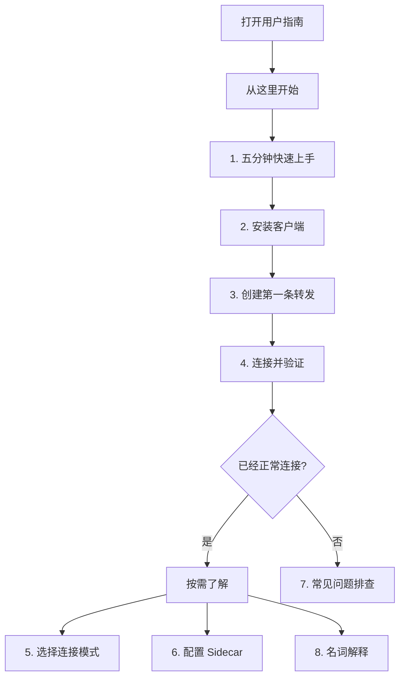
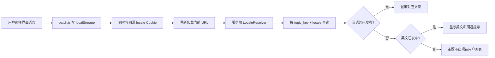
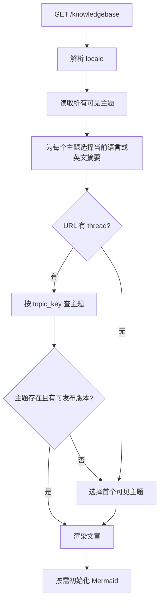

# 多语言用户指南重构设计

**日期：** 2026-07-29  
**状态：** 已确认  
**范围：** 面板内面向终端用户的知识库、指南入口及对应后台编辑能力

## 1. 背景

当前用户指南存放在 `knowledgebase_threads.body_html` 中。四篇默认文章把英文和繁体中文逐句混排，并直接使用 `Forward Combination`、`slave`、`leg`、`runtime`、`sidecar` 等术语。读者需要一边翻译、一边理解内部实现，才能完成首次连接。

现有界面支持 `en`、`zh-Hans`、`zh-TW` 三种语言，但语言切换由浏览器端 `public/i18n/patch.js` 在页面加载后替换短文本。它不适合翻译长篇文章，也无法让知识库服务在服务端选择对应语言正文。

本次重构的目标不是增加更多技术说明，而是让第一次使用项目的用户能够：

1. 清楚知道下一步做什么；
2. 明白每个字段为什么要填；
3. 知道操作成功时会看到什么；
4. 失败时能按症状进入正确的排障路径；
5. 在英文、简体中文、繁体中文之间切换时，不再看到逐句混排的内容。

## 2. 已确认的产品决策

- 主要读者是不了解项目内部术语的新手用户。
- 覆盖全部面板用户指南，不扩展到运维交接、开发设计和部署文档。
- 英文、简体中文、繁体中文分别维护独立正文。
- 知识库跟随当前界面语言自动显示对应版本。
- 同一主题的三种语言使用稳定主题键配对。
- Mermaid 用在关键流程、选择和拓扑关系上，不机械复述每个编号步骤。
- 旧知识库链接保持有效。
- 当前语言版本缺失时回退到英文，并明确告知用户。

## 3. 用户信息架构

知识库改为“先完成任务，再按需理解”的两层结构。



### 3.1 八个主题

| 顺序 | 稳定主题键 | 中文标题 | 解决的问题 | Mermaid 用途 |
|---|---|---|---|---|
| 1 | `getting-started-five-minute-overview` | 五分钟快速上手 | 第一次使用时完整路径是什么 | 套餐、转发、客户端、验证总流程 |
| 2 | `install-client` | 安装客户端 | Windows、Android、Linux 分别怎么安装 | 按设备选择安装方式的分支图 |
| 3 | `getting-started-first-forward-checklist` | 创建第一条转发 | 表单怎么填、保存后看哪里 | 填写与发布状态流 |
| 4 | `connect-and-verify` | 连接并验证 | 应该连接哪个地址，如何确认成功 | 本机地址与公网地址选择流程 |
| 5 | `connection-modes-single-race-bond` | 选择连接模式 | Single、Race、Bond 有什么体验差别 | 按稳定、容错、聚合需求决策 |
| 6 | `bond-sidecar-setup` | 配置 Sidecar | 何时需要 Sidecar，如何配置 | Client 到目标服务的拓扑图 |
| 7 | `troubleshooting-common-mistakes` | 常见问题排查 | 无心跳、连不上、端口不通、模式异常怎么办 | 按症状展开的排障树 |
| 8 | `glossary` | 名词解释 | 必须出现的产品词和网络词是什么意思 | 不强制配图，优先短定义和交叉链接 |

四个现有主题键原样保留，因此下列链接继续有效：

- `getting-started-first-forward-checklist`
- `connection-modes-single-race-bond`
- `bond-sidecar-setup`
- `troubleshooting-common-mistakes`

`/tenant/getting-started` 继续承担“根据当前账号状态告诉用户下一步”的轻量入口，不再复制长篇指南。它应链接到以上知识库主题；长篇操作说明只维护一份。

## 4. 文章写作模板

每个语言版本使用相同结构，但不是逐句直译。译文应符合目标语言的自然表达和对应界面按钮名称。

1. **你将完成什么**：一至两句话说明结果。
2. **开始前准备**：账号、套餐、设备、权限和必要地址。
3. **操作步骤**：短句、编号、一次只描述一个动作。
4. **关键流程图**：帮助用户判断路径或理解关系。
5. **成功标志**：明确状态、时间或可观察结果。
6. **如果没有成功**：按症状链接到本篇小节或排障主题。
7. **相关主题**：只链接最可能需要的下一篇内容。

### 4.1 写作规则

- 优先描述用户能看到和能操作的对象，不先解释内部实现。
- 内部术语不是完成任务所必需时直接删除。
- 必须出现的术语先用普通语言解释，再链接到名词解释。
- 按钮名称使用当前语言界面中的正式名称；首次出现时可附英文原名。
- 一句话只表达一个动作或一个判断。
- 不使用“English: / 中文：”或斜杠逐句混排。
- 不把“保存成功”当作最终成功标准；应说明连接、心跳或状态应变成什么。
- 不承诺未经系统保证的性能、带宽或故障切换效果。

## 5. 多语言内容模型

采用“主题 + 独立语言文章”的两层模型。

### 5.1 `knowledgebase_topics`

主题级数据只保存一份：

- `id`
- `topic_key`：稳定 URL 标识，唯一
- `is_pinned`
- `sort_order`
- `created_at`
- `updated_at`

### 5.2 `knowledgebase_articles`

每种语言保存一条完整记录：

- `id`
- `topic_id`
- `locale`：只允许 `en`、`zh-Hans`、`zh-TW`
- `author_user_id`
- `title`
- `excerpt`
- `body_html`
- `status`：`draft` 或 `published`
- `published_at`
- `created_at`
- `updated_at`

约束：

- `(topic_id, locale)` 唯一；
- 删除主题前必须显式处理其文章，避免孤儿记录；
- 排序和置顶属于主题，不在三个语言版本中重复；
- 三个语言版本允许独立保存草稿，但发布完整度会在后台明确显示。

现有 `knowledgebase_threads` 数据迁移到新模型。四篇默认混排文章由全新 24 个语言版本替代。其他管理员自建文章迁移为英文版本，保留原标题和正文，避免静默丢失内容。

## 6. 语言解析与回退

当前语言必须同时对浏览器端短文本替换和服务端知识库查询可见。



语言优先级：

1. 有效的 `?lang=` 查询参数；
2. 同源 locale Cookie；
3. `en`。

`?lang=` 被使用时，同时更新 localStorage 和 Cookie，保证浏览器端与服务端一致。未知语言值统一视为 `en`，不得直接拼入查询。

切换语言只重新加载当前 URL，不改 `thread` 参数。因此用户停留在同一主题，不会被送回知识库首页。

回退到英文时，文章顶部显示可见提示，例如：“此主题暂未提供简体中文版本，当前显示英文。”提示文本由普通界面 i18n 字典提供。

## 7. 知识库读取流程



知识库列表只显示至少有一个可发布版本的主题。列表标题和摘要使用与正文相同的语言回退规则，防止侧栏显示中文、正文却静默变成英文。

URL 继续使用 `/knowledgebase?thread=<topic_key>`。不为语言创建独立 slug，也不把语言编码进稳定链接。

## 8. Mermaid 设计与安全边界

### 8.1 作者格式

文章正文中的图表使用：

```html
<pre class="mermaid">
flowchart TD
    A[开始] --> B[下一步]
</pre>
```

每张图还必须有一段普通文字结论。图表不能是完成任务所需信息的唯一来源。

### 8.2 渲染方式

- Mermaid 使用仓库内固定版本的静态资源，不使用公网 CDN。
- 仅当当前文章包含 `.mermaid` 容器时加载和初始化。
- 使用 `securityLevel: "strict"`。
- 禁用 Mermaid HTML labels，降低注入面并提高样式一致性。
- 优先使用 `flowchart TD`，适应窄屏纵向阅读。
- 每张图原则上控制在 5 至 12 个节点；超过时拆成两张图。
- SVG 宽度限制为正文宽度，允许按比例缩放，不让页面横向溢出。
- 图表节点文字由各语言文章独立维护，一张图内不混排三种语言。

### 8.3 失败与无 JavaScript 降级

- 管理员发布前，编辑器使用本地 Mermaid 解析器检查所有图表；解析错误时阻止发布并指出第几张图失败。
- 运行时仍对每张图单独捕获异常。单图失败不影响文章正文和其他图表。
- 无 JavaScript 时，文章的标题、步骤、成功标准和排障文字仍完整可读。
- 图表附近显示文本结论；原始 Mermaid 源可作为降级内容保留在 `pre` 中。

### 8.4 正文 HTML 边界

现有正文会直接插入页面。重构时增加知识库专用 HTML 允许列表，只保留文章所需标签和属性。至少允许标题、段落、列表、强调、链接、代码、表格、引用和 `pre.mermaid`；删除 `script`、`iframe`、事件处理属性和不受控样式。

管理员仍是受信任作者，但文章输出不应依赖“管理员永远不会粘贴危险 HTML”这一假设。

## 9. 后台编辑体验

后台从“线程列表”改为按主题组织：

- 每个主题显示英文、简体中文、繁体中文三个状态标签；
- 一次只编辑一种语言，避免三套正文挤在同一表单；
- 主题级设置单独编辑，包括主题键、顺序和置顶；
- 文章编辑器显示当前语言，避免误改其他版本；
- 发布前支持正文和 Mermaid 预览；
- 标题、摘要、正文为空时不能发布；
- `topic_key + locale` 重复时拒绝保存；
- Mermaid 解析错误时允许保存草稿，但不能发布；
- 删除主题或语言版本需要沿用现有管理权限和 CSRF 保护。

## 10. 迁移和兼容策略

迁移必须保留未知的管理员自建内容，并保证旧链接继续工作。

1. 创建新主题表和语言文章表。
2. 识别四个仓库内置旧主题；它们不迁移旧的混排正文，只保留稳定主题键、排序和置顶信息。
3. 将其余管理员自建 `knowledgebase_threads` 迁移为主题和英文文章版本，保留原标题、摘要和正文。
4. 对四个内置旧主题按稳定主题键写入全新的三语言内容。
5. 新增其余四个主题及三语言内容。
6. 切换读取和后台写入逻辑到新模型。
7. 保留旧表，直到新读取路径和生产数据迁移验证完成；本变更不直接丢表。
8. 更新面板内指南入口文案和主题链接。

迁移和默认内容写入必须幂等。首次执行时按 `topic_key` 和 `(topic_id, locale)` 插入缺失记录；同一迁移重复执行时只补齐缺失记录，不更新已经存在的正文。这样既不会制造重复主题，也不会覆盖管理员已经修改的内容。

默认指南由一次性版本迁移建立；迁移后管理员可以在面板继续维护。后续需要更新仓库内置指南时，必须使用新的显式内容迁移，并只修改仍处于上一内置版本的记录；不得在每次请求或每次部署时无条件覆盖管理员编辑。

## 11. 内容验收标准

### 11.1 完整度

- 8 个主题全部存在。
- 每个主题有 `en`、`zh-Hans`、`zh-TW` 三个已发布版本，共 24 个默认版本。
- 每个版本都有标题、摘要、正文、成功标志和失败出口。
- 除名词解释外，每个主题至少有一张真正帮助理解或判断的 Mermaid 图。

### 11.2 语言质量

- 不出现 `English:`、`中文：`或逐句斜杠混排。
- 英文、简体中文、繁体中文正文分别自然可读。
- 必要的产品名、协议名、IP 地址和按钮英文原名不计为语言混杂。
- 三种语言的步骤、限制、成功标准和排障分支语义一致。
- 简体和繁体不是只做字符替换；涉及本地用词和界面按钮时分别校对。

### 11.3 用户任务

新用户只阅读前四篇，应能回答：

- 我现在处于哪一步；
- 下一步点击哪里；
- 需要准备哪些值；
- 成功后应该看到什么；
- 失败后应该打开哪篇排障内容。

## 12. 测试设计

### 12.1 服务和数据测试

- 主题排序和置顶在三种语言下保持一致。
- 当前语言存在时返回该语言。
- 当前语言缺失时回退到英文并返回回退标志。
- 英文也缺失时用户列表隐藏该主题。
- 未知 locale 回退到英文。
- `(topic_id, locale)` 唯一约束生效。
- 迁移重复执行不会产生重复记录。
- 自建旧文章迁移后仍可读取。

### 12.2 读取页面回归测试

- 四个旧 `thread` 链接仍打开对应主题。
- 切换语言后 `thread` 参数保持不变。
- 侧栏和正文使用相同语言或显示明确回退提示。
- 页面不再输出旧的逐句双语正文。
- 无已发布内容时保持清晰空状态。

### 12.3 后台回归测试

- 主题列表显示三个语言状态。
- 可以创建、编辑和发布单个语言版本。
- 空标题、空摘要、空正文不能发布。
- 重复语言版本不能保存。
- 无效 Mermaid 可以保存为草稿，但不能发布。
- 正文过滤器移除脚本、iframe、事件属性和不允许的样式。
- 合法的 `pre.mermaid`、列表、链接和代码块仍被保留。

### 12.4 Mermaid 和前端测试

- 本地 Mermaid 资源存在且不引用 CDN。
- 只在有图表的文章页初始化。
- 所有 21 个以上默认图表均可解析。
- 单张图失败不会阻止文章显示。
- 无 JavaScript 时关键文字仍存在。
- 360px 宽度下图表不撑破正文。

### 12.5 人工验收

分别用 `en`、`zh-Hans`、`zh-TW` 完整走读前四篇，并在桌面与移动宽度检查：

- 主题顺序；
- 语言自然度；
- 按钮名称是否与当前界面一致；
- Mermaid 字体、方向和缩放；
- 成功标准是否可观察；
- 排障链接是否到达正确主题。

## 13. 不在本次范围内

- 重写 `docs/` 下的运维交接、架构设计和开发计划。
- 重写 slave-agent、Android 子项目或第三方组件的 README。
- 为知识库引入全文搜索、评论、附件或版本历史。
- 自动机器翻译管理员新建文章。
- 改造整个站点的 i18n 架构；本次只补充服务端可读取的 locale 同步能力。
- 修改转发、客户端、Sidecar 或连接模式本身的数据面行为。

## 14. 完成定义

当以下条件同时满足时，本次重构完成：

1. 新数据模型和迁移已通过测试；
2. 8 个主题、24 个语言版本全部发布；
3. 界面语言切换能保持当前主题并选择正确正文；
4. 四个旧主题链接保持兼容；
5. Mermaid 本地、安全、按需渲染，失败时正文仍可读；
6. 后台能按主题查看三语言完整度并分别编辑；
7. 自动测试和三语言桌面/移动人工验收通过；
8. 用户指南正文不再逐句混排多种语言。
